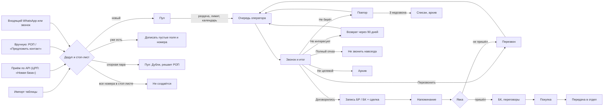
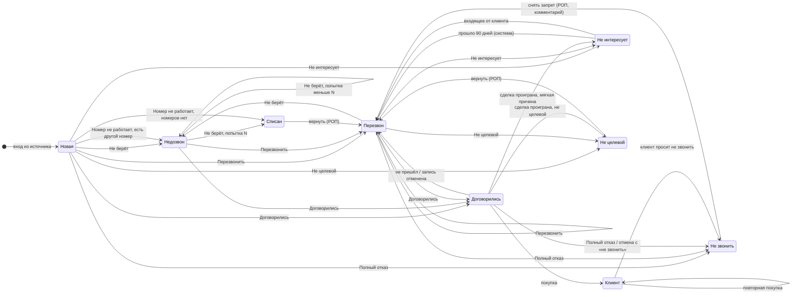

# Процессы продаж в CRM: как это работает

Статус: **проект architect от 20.10.2026, ред. 2 после ревью; ред. 3 от
21.10 — уточнения §2.6, §3.4, §3.5 и §12 по тест-векторам K1d**. Он становится
нормой после того, как владелец подтвердит решения из раздела 15 и ответит на
вопросы раздела 14 и `docs/PLAN.md` §9. До
этого агенты пишут код по значениям «по умолчанию» и не считают открытые вопросы
решёнными.

Документ описывает логику процессов продукта. Значения взяты из пресета первого
клиента, ЦРП. Как хранятся настройки — `docs/CONFIG.md`; ключи вида
`calling.retry.maxAttempts` окончательные там. Таблицы и колонки в столбце «Как
хранится» соответствуют `docs/ARCHITECTURE.md` §4. Решения — `docs/DECISIONS.md`.

Пометки в тексте:
- **[код]** — правило зашито в продукт и одинаково у всех компаний;
- **[настройка]** — меняется настройкой без правки кода;
- **[ЦРП]** — значение пресета ЦРП;
- **[вопрос N]** — зависит от ответа владельца, см. раздел 14.

Все компании, люди и номера в примерах выдуманы. Номера начинаются с +7 709:
этот код не выдан ни одному оператору связи.

Источники, по которым собрана модель: требования владельца из переписки (главный
источник), план владельца на 10 дней, регламент операторов ЦРП, разбор рабочих
таблиц операторов (только агрегаты), голосовая заметка оператора, разбор CRM ЦРП
в SalemAI (ветка `integration/crp-wave1`, SHA 108fb70), разборы Wazzup, телефонии
РК и UX-паттернов.

---

## Содержание

1. Словарь
2. Жизненный цикл компании: от источника до покупки
3. Машина состояний карточки обзвона
4. Сделки и воронка продаж (канбан)
5. Запись на мероприятия
6. Задачи
7. Раздача
8. Роли и доступ
9. История клиента (лента)
10. Отчёты и показатели
11. Уведомления
12. Граничные случаи и правила целостности
13. Что настраивается под другую компанию
14. Открытые вопросы к ЦРП и владельцу
15. Решения этого документа (перенесены в `docs/DECISIONS.md`)
16. Разрезка работ (перенесено в `docs/PLAN.md` §4)

---

## 1. Словарь

| Термин | Что это | Как хранится | Пример |
|---|---|---|---|
| **Клиент** | Компания или человек, с которым работает отдел. Запись появляется в момент входа в CRM (импорт, приём по API, ручное добавление, входящее сообщение) и живёт всегда. Это главная сущность: у неё поля, контакты, телефоны, лента, сделки. В интерфейсе оператора, пока нет договорённости, она называется «карточка»; в списке «Мои клиенты» — после договорённости | `clients` (`kind`: компания / физлицо) | ТОО «Пример Строй», Астана |
| **Лид** | Не отдельная сущность, а клиент на этапах обзвона, до договорённости. Слово используется в отчётах и API («приём лидов») | клиент + карточка обзвона в состоянии до «Договорились» | — |
| **Компания** | Клиент вида «компания». Ключи: БИН, название без формы собственности, телефоны | поля клиента | ТОО, ИП, АО |
| **Контакт** | Человек у клиента: ЛПР, секретарь, бухгалтер. У контакта роль, имя, телефоны, заметка «когда звонить» | `contacts` | Ерлан Пример, директор |
| **ЛПР** | Лицо, принимающее решение (руководитель, владелец). Признак на карточке: «да», «нет», «не выяснено». «Не выяснено» не равно «нет» | `cards.lpr` | ЛПР: да |
| **Телефон** | Номер клиента или контакта, нормализованный к виду `+7XXXXXXXXXX`. Признаки: тип (мобильный / городской / неизвестный), рабочий / нерабочий, основной, «есть WhatsApp» (да / нет / не знаем) | `client_phones` | +7 709 123 45 67, мобильный |
| **Карточка обзвона** | Состояние клиента в воронке обзвона одного пространства: владелец, состояние, попытки, срок следующего звонка, последний итог, ЛПР, «целевой». У клиента в пространстве ровно одна карточка; повторный цикл (возврат через 90 дней) — та же карточка | `cards` (1:1 с клиентом в пространстве) | «Пример Строй»: Перезвон чт 15:30, попытка 0 из 3 |
| **Владелец** | Сотрудник, который отвечает за клиента в пространстве. Оператор видит только клиентов, где он владелец (или временный владелец) | `cards.owner_user_id` | Оператор А |
| **Временный владелец** | Коллега, которому на время отсутствия владельца переданы его перезвоны и повторы. Срок задан датами отсутствия | `cards.acting_user_id` + `absences` | Оператор Б до 30.10 |
| **Сделка** | Попытка продать клиенту услугу. Начинается с договорённости (запись на БР или БК) или с покупки. У клиента может быть сколько угодно сделок | `deals` | «Сделка №2: SMM» |
| **Воронка** | Набор этапов, по которым движется объект. Воронок две: **обзвон** (по карточкам, состояния фиксированы в коде) и **продажи** (по сделкам, этапы настраиваются). В будущих пространствах свои воронки | настройка `pipelines[]` (ключи), `deals.pipeline_key` | «Продажи ЦРП» |
| **Этап** | Шаг воронки продаж. Вид этапа: открыт / выигран / проигран. У этапа обязательные поля, срок «залежалось», кто может переносить | `pipelines[].stages[]`, `deals.stage_key` | «Пришёл» |
| **Состояние карточки** | Шаг воронки обзвона (раздел 3): Новая, Недозвон, Перезвон, Договорились, Клиент, Не интересует, Не целевой, Не звонить, Списан | `cards.state` | Перезвон |
| **Звонок** | Факт попытки связаться: кто, когда, с какого номера на какой, длительность (оценка или от АТС), запись разговора, итог | `calls` | 29.10 10:03, 2:40 |
| **Итог звонка** | Ровно одно значение, которое оператор ставит после звонка. У итога есть **вид** (поведение, зашито в коде, 7 видов) и **подпись, цвет, причины** (справочник компании) | настройка `calling.outcomes[]`, `calls.outcome_code` + `calls.outcome_kind` | «Не берёт» |
| **Дозвон** | Звонок, итог которого означает разговор с человеком (виды: перезвонить, договорились, не интересует, не целевой, полный отказ) | вычисляется по виду итога | — |
| **Попытка** | Звонок без разговора (вид «не берёт»). Счётчик попыток идёт подряд и обнуляется любым дозвоном | `cards.attempts` | попытка 2 из 3 |
| **Повтор** | Автоматически назначенный следующий звонок после недозвона. Время считает система по правилу (раздел 3.4), оператор его не вводит | `cards.next_call_at` при состоянии «Недозвон» | повтор сегодня 12:14 |
| **Перезвон** | Звонок в согласованное с человеком время. Время вводит оператор, оно обязательно. Срок хранит карточка; задача владельцу — её проекция, создаётся и закрывается в той же транзакции (D-050) | `cards.next_call_at` при `state = 'callback'` (источник правды) + задача вида «звонок» | перезвон чт 15:30 |
| **Пул** | Карточки без владельца, которые ждут раздачи. Видит только РОП. Разделы пула: «Готовы к раздаче», «Сверх лимита», «Дубли», «Спорные из импорта», «Предложены операторами», «Без рабочего номера», «Задержаны правилом», «Без владельца (не новые)» — страховочный раздел, в норме пуст (D-066) | `cards.owner_user_id IS NULL` | Пул: 312 |
| **Запас** | В CRM: сколько карточек в пуле готово к раздаче, в штуках и в рабочих днях (пул / (операторы × лимит)). Запас источника на 7 рабочих дней живёт вне CRM; источник отдаёт CRM только потребность ближайшего рабочего дня плюс буфер (D-057) | вычисляется | запас 312 = 0,8 дня |
| **Раздача** | Назначение владельца карточкам из пула: автоматически по расписанию или вручную РОП. Всегда в пределах дневного лимита | `assign_log` | 28.10 08:00, авто, 400 карточек |
| **Лимит** | Сколько **новых для оператора** карточек он может получить за рабочий день: из авто-раздачи, ручной раздачи и возвратов «Не интересует» | настройка | 40 |
| **Очередь «Звонить»** | Карточки оператора, по которым пора звонить сейчас, в порядке приоритета. Оператор видит одну карточку за раз | вычисляется | к звонку сейчас: 14 |
| **Пропуск** | «Пропустить» без итога: карточка уходит в конец сегодняшней очереди. Число пропусков в день ограничено | счётчик за день | пропусков 2 из 10 |
| **Стоп-лист** | Номера, по которым звонить нельзя никогда («Не звонить»). Хранится отдельно от клиентов, по хешу номера, и переживает слияние, удаление и обезличивание | `stop_list` (HMAC номера) | — |
| **Спорная пара** | Две карточки с общим номером, но разными названиями (или одинаковым названием и руководителем без общего номера). Не склеиваются автоматически: решает РОП. Принцип: ложная склейка хуже дубля | `dup_pairs` | ТОО «Пример» и ИП «Пример», один номер |
| **Источник** | Откуда пришёл клиент: импорт таблицы, приём по API, вручную, входящий WhatsApp, входящий звонок. Пользователь видит подпись источника из настроек | `clients.source_kind`, `clients.source_key`, `client_sources`; подпись — настройка `sources[].label` | «Новая база» |
| **БР, бизнес-разбор** | [ЦРП] Бесплатное групповое мероприятие: серия по четвергам 15:00, 30 мест. В продукте это «групповое мероприятие» | `event_series`, `events`, `bookings(kind=group)` | БР чт 29.10 15:00 |
| **БК, бизнес-консультация** | [ЦРП] Индивидуальная встреча с консультантом, слот 45 минут. В продукте это «консультация» | `bookings(kind=individual)` | БК пн 09.11 11:00 |
| **Запись** | Место клиента на мероприятии или в слоте консультанта. Статусы: записан, подтвердил, пришёл, не пришёл, перенесена, отменена | `bookings` | — |
| **«Серая» БК** | Заявка на консультацию без консультанта: время выбрано, консультанта назначит система (утренний прогон и каждые 30 минут) или РОП | `bookings.resource_id IS NULL` | — |
| **Перенос записи** | Новая запись вместо старой; старая получает статус «перенесена» и ссылку на новую. Вторая активная запись того же клиента на тот же вид мероприятия не создаётся | `moved_to_id`, `moved_from_id` | — |
| **Явка** | Отметка «пришёл» или «не пришёл» по записи. На БР ставит дежурный, на БК — консультант | статус записи | — |
| **Дежурный** | Сотрудник, назначенный на конкретное мероприятие отмечать явку. Не роль, а назначение. [ЦРП] По умолчанию дежурит РОП | `event_duty` | — |
| **Покупка** | Выигранная сделка: тип услуги, сумма в целых тенге, дата. Регистрирует консультант или РОП | сделка на этапе вида «выигран» | SMM, 450 000 ₸ |
| **Тип услуги** | Справочник того, что продаёт компания. У типа может быть отдел, которому уходит передача | настройка `serviceTypes[]`, `deals.service_type_key` | «Мастер-группа», «SMM» |
| **Передача клиента** | Смена владельца клиента внутри пространства (РОП передаёт клиентов от оператора к оператору). Прежний владелец сразу теряет доступ | `assign_log` (вид `transfer`) + `client_events` | от Оператора А к Оператору Б |
| **Передача в отдел** | Отправка покупки другому отделу (маркетинг, автоматизация) со сводкой о клиенте. Отдел принимает и назначает исполнителя | `handoffs` + задача | покупка SMM → глава маркетинга |
| **Отдел** | Группа сотрудников с руководителем; получает передачи. Сейчас отдел — команда внутри пространства «Продажи», позже — своё пространство | `teams` | Маркетинг |
| **Задача** | Дело с исполнителем и сроком, всегда привязанное к клиенту. Бывают системные (перезвон, «ответить в WhatsApp», «принять передачу») и ручные | `tasks` | «Перезвонить чт 15:30» |
| **Лента** | История клиента: все события в одном списке, только добавление. История сделки — та же лента с фильтром по сделке | `client_events` | — |
| **Пространство** | Рабочая область отдела со своими воронками, полями, ролями и раздачей. Клиент общий для установки, карточка и владелец свои в каждом пространстве. В интерфейсе пока одно пространство: «Продажи» | `spaces`, `memberships` | «Продажи» |
| **Рабочий календарь** | Рабочие дни, часы и праздники с переносами, часовой пояс. Определяет повторы, раздачу, сроки задач и напоминаний | настройка `calendar.*`, `org.timezone` | пн–пт 09:00–18:00, Asia/Almaty |
| **Установка** | Одна компания = одна установка = своя БД. Внутри может быть несколько пространств | — | CRM ЦРП |

---

## 2. Жизненный цикл компании: от источника до покупки

### 2.1 Общая схема



### 2.2 Источники

| Источник | Кто запускает | Что происходит | Особенности |
|---|---|---|---|
| **Импорт таблицы** (CSV, XLSX) | РОП (разрешение `import.run`); администратор — только если совмещён с ролью РОП: предпросмотр показывает названия и номера | Загрузка файла → сопоставление колонок с полями (профиль импорта сохраняется) → карта значений (например, «Отключен/Не берет» → итог «Не берёт») → **предпросмотр** (сколько новых, дублей, спорных, в карантине, сколько получит каждый оператор) → «Применить». Повтор того же файла ничего не дублирует; повторная загрузка с изменившимися итогами применяет только изменения (12.14) | Загрузка файла и ПДн — только по дизайну architect. Владелец строки задаётся колонкой «оператор» или картой «диапазон строк → оператор» (для таблиц ЦРП). Состояние карточки, которую уже вели в CRM, импорт не перезаписывает. Профиль «Записи» загружает уже сделанные записи на мероприятия (12.39) |
| **Приём по API** (`POST /api/ingest/v1/leads`, контракт — `INTEGRATIONS.md` §5) | Внешняя система по ключу | Пачка до 1000 записей, у каждой внешний ID. Ответ по каждой записи (только если у источника включён подробный отчёт): принята / дубль / стоп-лист / без рабочего номера / задержана правилом / отклонена правилом. Повтор пачки безопасен | [ЦРП] Источник — программа владельца в отдельном контейнере. В CRM он виден только как источник с подписью «Новая база». В ответах API и в CRM нет ни слова о нём |
| **Вручную, РОП** | РОП | Форма «Новый клиент» с проверкой дублей; можно сразу назначить владельца (входит в лимит) | — |
| **«Предложить контакт», оператор** | Оператор | Оператор вводит номер и название, например по звонку от знакомого. Ответ всегда одинаковый: «Принято. Карточка появится в очереди после проверки». Если совпадений нет, карточка придёт ему со следующей раздачей (не входит в лимит). Если совпадение есть, предложение уходит РОП в «Пул: Предложены» | Ответ не говорит, есть ли номер в базе (раздел 8.3). Входит в общий лимит проверок номера — 20 в день [настройка, D-040] |
| **Входящее сообщение WhatsApp** (Wazzup, за флагом) | Система | Номер известен → сообщение в ленту клиента, задача владельцу «Ответить». Номер неизвестен → новый клиент (источник «WhatsApp, входящее»), карточка «Новая», владелец по правилу входящих (раздел 7.7), задача «Ответить» | Номер, у которого несколько клиентов, → к клиенту с последней активностью и отметка «проверить» для РОП |
| **Входящий звонок** (телефония за флагом) | Система | Так же, как WhatsApp. Пропущенный от известного → задача владельцу «Перезвонить (пропущенный)» | В режиме manual входящих событий нет; оператор вносит звонок вручную через поиск по своим |

### 2.3 Дедуп

Проверка идёт на сервере в одной транзакции с созданием, под общей блокировкой
приёма: её берут все пути, создающие клиента (приём, импорт, ручное создание,
«Предложить контакт», входящие), поэтому две пачки с одним номером не создадут
два клиента (D-022). Порядок правил **[код]**, пороги **[настройка]**:

1. **Нормализация.** Телефоны: разбить ячейку на номера (`,` `;` `/`, перевод
   строки, два пробела, «и»; два номера через один пробел тоже делятся),
   привести к `+7XXXXXXXXXX` (8 → 7, 10 цифр → 7 + цифры), добавочный («доб.»,
   «x», «#») — отдельно, определить тип по префиксу (правило номеров РК),
   заглушки сохранить как нерабочие. Заглушка — номер по шаблону из настроек
   (по умолчанию абонентская часть из нулей) или одинаковые цифры при
   неизвестном коде; «красивый» номер с известным кодом (+7 709 777 77 77) —
   рабочий (D-144). Название: убрать форму собственности (ТОО, ИП, АО, ЖШС,
   «Товарищество с ограниченной ответственностью»), кавычки, регистр, ё → е.
   Форма собственности — из колонки «Тип» (любое написание: «ИП.»,
   «Индивидуальный предприниматель», «ЖК», «Жеке кәсіпкер», «Т.О.О.»; также ГКП,
   КХ, ГУ, ОО, ПК), иначе из названия; «ЖК» и «ПК» в названии формой не считаются
   («жилой комплекс», «Сервис ПК»); нераспознанное
   значение «Тип» — строка на разбор (D-141). БИН: ровно 12 цифр, иначе пусто.
2. **Стоп-лист.** Номер из стоп-листа отбрасывается (не сохраняется и не
   попадает в карточку). Если рабочих номеров не осталось → запись не
   создаётся (приём: статус «стоп-лист»; импорт: строка в отчёте), данные не
   сохраняются. Если остался хотя бы один рабочий номер не из стоп-листа —
   запись идёт дальше по правилам 3–7 (D-021).
3. **Тот же клиент**, если совпал БИН; иначе если совпал рабочий номер **и**
   нормализованное название (или у одной стороны названия нет). Без рабочего
   номера — если совпали название **и** записанная заглушка. Не склеиваем, а
   ставим спорную пару, если у сторон разные непустые БИН/ИИН или разные
   известные формы собственности («ТОО Альфа» и «ИП Альфа» с общим номером)
   (D-142). Тогда существующему клиенту дописываются только **пустые** поля и
   новые номера. Состояние карточки, владелец, итоги не меняются никогда:
   закрытую карточку повторный приём не «воскрешает». Если у дубля другой итог
   (в том числе «не звонить») — строка импорта идёт на разбор РОП, а не
   теряется (D-143).
4. **Спорная пара**, если совпал номер, но название другое (бухгалтер или
   директор на несколько фирм), либо совпали название и руководитель без общего
   номера (в том числе у записи без рабочего номера). Создаётся новый клиент и
   пара «на проверку». Пара не делится между операторами (раздел 7.6).
5. **Без рабочего номера** — клиент создаётся (если источник — импорт), но
   карточка уходит в «Пул: Без рабочего номера» и не раздаётся.
6. **Отклонён правилом** [настройка, `rejectRules`] — запись не сохраняется
   вовсе. [ЦРП] У источника «Новая база» — ИП до ответа юриста (D-052).
7. **Задержан правилом** [настройка, `holdRules`] — например, [ЦРП] регион не
   Астана; ИП из собственных таблиц ЦРП до ответа юриста. Клиент создаётся, в
   раздачу не идёт.

У формы собственности с признаком «номер — личный» ([ЦРП] ИП) 12 цифр — это
ИИН: хранится только HMAC, открыто — никогда, на любом пути входа (D-052).
Дедуп сравнивает такие номера тоже только по HMAC. Если форма не определена
(нет ни колонки «Тип», ни формы в названии, или «Тип» не распознан), 12 цифр
скрываются как ИИН «по неуверенности»: если тот же номер открыт как БИН у
клиента в базе или у строки того же файла — это БИН и тот же клиент (п. 3).
Другой открытый БИН склейке по номеру и названию не мешает, но строка идёт на
разбор (D-141).

Пример. Пришла запись «Товарищество с ограниченной ответственностью "Пример
Строй"», телефон «8 709 123 4567, +7 709 765 43 21». После нормализации: название
«пример строй», номера +77091234567 (мобильный) и +77097654321 (мобильный). В
базе есть «ТОО Пример Строй» с номером +77091234567 → тот же клиент, второй номер
дописан, больше ничего не меняется.

### 2.4 Пул и раздача

Новая карточка без владельца попадает в пул. Раздача (раздел 7) по расписанию
выдаёт карточки операторам поровну в пределах дневного лимита. Всё, что не
поместилось, ждёт в пуле: «Сверх лимита». РОП видит пул и запас базы.

### 2.5 Очередь оператора и звонок

1. Утром оператор открывает «Звонить». Сверху счётчик «К звонку сейчас: 14 ·
   просрочено: 2», вкладки «Все / Перезвоны / Повторы / Новые», ниже одна
   карточка: название, ЛПР, попытка, последний итог, заметка, номера.
2. «Позвонить» открывает звонилку телефона (режим manual: ссылка `tel:`) или
   звонок через АТС (адаптер телефонии). Перед этим CRM создаёт «намерение
   звонка» с ID, временем и номером.
3. Когда оператор возвращается в приложение, сама открывается шторка итога (даже
   если телефон выгрузил приложение: намерение хранится на устройстве).
4. Оператор ставит итог (раздел 3). «Не берёт» — одно нажатие, следующая
   карточка показывается сразу. Итог 5 секунд ждёт на устройстве и только потом
   уходит на сервер; в эти 5 секунд его можно отменить, сервер отменённый итог
   не видит («Следующая» отправляет сразу). «Договорились — записать» работает
   только онлайн и окна отмены не имеет: ошибку исправляют отменой записи (D-019).
5. Без сети итог копится на телефоне и отправляется позже; сервер не создаёт
   дубль (у итога ID, созданный на устройстве).

### 2.6 Итоги, повторы, перезвоны, квалификация

- **Не берёт** → повтор по правилу (через 2 часа, затем следующий рабочий день
  10:00). Третий недозвон подряд → «Списан».
- **Номер не работает** → номер помечается нерабочим; если есть другой рабочий
  номер, карточка сразу встаёт в очередь с ним; если нет — «Списан» с причиной
  «Нет рабочего номера». Оператор может тут же добавить новый номер, найденный
  в 2ГИС или на сайте.
- **Перезвонить** → дата и время обязательны (быстрые: «+2 ч», «завтра 10:00»,
  «чт 10:00», «другое»). Создаётся задача-перезвон владельцу.
- **Квалификация.** При дозвоне с итогами «Перезвонить», «Договорились», «Не
  интересует» оператор отмечает ЛПР: «да» или «нет» (обязательно [ЦРП],
  `calling.lprRequiredOnContact`). У «Не целевой» и «Полный отказ» ЛПР не
  обязателен: компания закрылась или собеседник отказал грубо, выяснять некого.
  При «нет» шторка предлагает поля «ЛПР: имя, прямой номер,
  когда звонить» — заполнить хотя бы одно или заметку [ЦРП]. Это выполняет
  требование регламента «не бросать контакт, выйти на ЛПР».
- **Целевой.** «Да» ставится сам при «Договорились» или вручную чипом.
  «Нет» — только итогом «Не целевой» с причиной. Отдельного статуса,
  противоречащего итогу, нет.

### 2.7 Запись, напоминания, явка

- **Договорились — записать** открывает мастер в той же шторке: БР (ближайший
  четверг, «осталось 12 мест из 30», 2 нажатия) или БК (направление → день → время
  → предложенный консультант или «назначим утром»). Запись создаёт сделку на этапе
  «Записан» (раздел 4).
- **Напоминания.** Оператор видит список «Напомнить сегодня / завтра» по своим
  клиентам и открывает WhatsApp с готовым текстом. Ответ клиента ставится одним
  нажатием: «Подтвердил», «Перенести», «Отменил».
- **Явка.** На БР — дежурный, на БК — консультант. «Пришёл» двигает сделку на
  «Пришёл»; если следующей записи нет — владельцу задача «Записать на
  следующий шаг» на следующий рабочий день 10:00. **«Не пришёл»** возвращает
  карточку владельцу в «Перезвон» на следующий рабочий день 10:00 с задачей
  «Не пришёл на БР 29.10, перезаписать».
- **Неотмеченная явка** закрывается сама: на следующий рабочий день в 10:00
  дежурный (или консультант) и РОП получают задачу «Отметьте явку»; через 2
  рабочих дня [ЦРП, настройка; вопрос В-11 PLAN] запись становится «Не
  пришёл» по тем же правилам (3.5, № 28).
- **Инвариант «Договорились».** У карточки в «Договорились» всегда есть
  активная будущая запись или открытая задача владельцу со сроком; ночная
  сверка находит нарушения и создаёт задачу (D-049).

### 2.8 БК, покупка, передача

- После БР оператор или консультант записывает на БК. Консультант после встречи
  пишет итог БК (заметка + следующий шаг) и, если договорились о работе, переводит
  сделку на «Переговоры».
- **Покупка**: консультант или РОП вносит тип услуги, сумму, дату. Сделка →
  «Покупка», карточка → «Клиент».
- **Передача в отдел**: если у типа услуги есть отдел ([ЦРП] SMM и реклама →
  маркетинг), система создаёт передачу и задачу руководителю отдела со сводкой о
  клиенте. Не приняли за рабочий день → тревога РОП.

### 2.9 Отказы, возвраты, архив

- **Не интересует** (причина обязательна) → карточка закрыта и вернётся тому же
  оператору через 90 дней [ЦРП] в пределах его дневного лимита.
- **Полный отказ** → «Не звонить»: в стоп-лист уходит номер, по которому был
  разговор, и номера, которые оператор отметил «тоже не звонить» (например,
  номер того же ЛПР). Номер, который есть у другого клиента (общий
  бухгалтер), уходит в стоп-лист только после подтверждения РОП (задача РОП).
  Карточка не возвращается никогда. Снять может только РОП с обязательным
  комментарием [вопрос В-12 PLAN].
- **Не целевой** (причина обязательна) → архив, сам не возвращается; РОП может
  вернуть вручную.
- **Списан** (3 недозвона или нет рабочего номера) → архив; РОП может вернуть.
- **Архив** — это не отдельное место, а закрытые состояния. Оператор видит свой
  архив, РОП — весь.
- **Обезличивание** по запросу субъекта ПДн: администратор запускает
  обезличивание; оно чистит все места из реестра ПДн (`ARCHITECTURE.md` §4.6:
  имена, телефоны, тексты, переписка, записи разговоров, строки импорта,
  внешние ID), номера уходят в стоп-лист по хешу, счётчики и суммы остаются для
  отчётов. В копиях БД данные исчезают не позже чем через 35 дней. Удаления
  клиентов кнопкой нет.

### 2.10 Пример: один клиент от входа до покупки

| Когда | Что | Кто | Состояние / этап |
|---|---|---|---|
| Ср 28.10 02:10 | Приём «Новая база»: ТОО «Пример Строй», +7 709 123 45 67 (моб.) | система | Новая, пул |
| Ср 28.10 08:00 | Авто-раздача: Оператору А (12-я из 40 за день) | система | Новая, Оператор А |
| Ср 28.10 10:14 | Звонок, «Не берёт» | Оператор А | Недозвон, попытка 1/3, повтор 12:14 |
| Ср 28.10 12:20 | Звонок, «Не берёт» | Оператор А | Недозвон, 2/3, повтор чт 29.10 10:00 |
| Чт 29.10 10:03 | Дозвон, ответила секретарь. ЛПР: нет; ЛПР Ерлан Пример, звонить после 15:00. «Перезвонить» чт 15:30 | Оператор А | Перезвон, попытки 0/3 |
| Чт 29.10 15:34 | Дозвон, ЛПР: да. «Договорились» → БР чт 05.11 15:00 | Оператор А | Договорились; сделка №1 «Записан» |
| Ср 04.11 11:00 | Список «Напомнить завтра» → WhatsApp → «Подтвердил» | Оператор А | запись «подтвердил» |
| Чт 05.11 15:05 | «Пришёл» | дежурный (РОП) | сделка №1 «Пришёл» |
| Пт 06.11 10:20 | Запись на БК: «Маркетинг», пн 09.11 11:00, предложен Консультант 2 (меньше записей в этот день) | Оператор А | запись БК |
| Пн 09.11 11:50 | «Пришёл», итог БК: «Отправлено КП» | Консультант 2 | сделка №1 «Переговоры» |
| Чт 12.11 14:00 | Покупка SMM, 450 000 ₸ | Консультант 2 | сделка №1 «Покупка», карточка «Клиент» |
| Чт 12.11 14:00 | Передача в маркетинг, задача главе маркетинга, срок пт 13.11 18:00 | система | передача «ждёт» |
| Пт 13.11 10:20 | Принял, назначил маркетолога | глава маркетинга | передача «принята» |

Итог по клиенту (собирается сам, раздел 9.3): 4 звонка, 2 дозвона, 2 попытки,
ЛПР найден 29.10, 2 записи и 2 явки, 1 покупка на 450 000 ₸, от входа до покупки
15 дней.

Отказной пример: ТОО «Пример Сервис», 23.10 «Не интересует», причина «Дорого» →
21.01.2027 (через 90 дней) карточка возвращается тому же оператору в первую
раздачу дня, если у него есть место в лимите.

---

## 3. Машина состояний карточки обзвона

### 3.1 Состояния

| Код **[код]** | Подпись [ЦРП] | Цвет [ЦРП] | В очереди «Звонить» | Смысл |
|---|---|---|---|---|
| `new` | Новая | серый | да (если есть владелец) | Ещё не звонили в этом цикле |
| `retry` | Недозвон | жёлтый | да, когда наступил `next_call_at` | Не дозвонились, ждём повтора |
| `callback` | Перезвон | синий | да, когда наступил `next_call_at` | Договорились созвониться в срок |
| `agreed` | Договорились | зелёный | нет | Есть активная будущая запись или открытая задача владельцу со сроком (инвариант D-049); дальше живёт сделка |
| `client` | Клиент | зелёный тёмный | нет | Была покупка |
| `not_interested` | Не интересует | оранжевый | нет; вернётся в `return_at` | Отказ ЛПР, мягкий |
| `not_target` | Не целевой | красный | нет | Не подходит по профилю (закрылась, не бизнес, вне региона) |
| `do_not_call` | Не звонить | красный | нет, никогда | Полный отказ; номер разговора (и отмеченные) в стоп-листе |
| `written_off` | Списан | серый тёмный | нет | 3 недозвона подряд или нет рабочего номера |

Владение не является состоянием: карточка `new` без владельца — это пул.
Закрытые состояния (`not_interested`, `not_target`, `do_not_call`, `written_off`)
сохраняют владельца — это его архив.

Цвет — свойство состояния в справочнике, а не данные строки. Красный у ЦРП —
цвет бренда, поэтому в теме «Не целевой» и «Не звонить» отображаются красным
**с текстом и значком**, а не одним цветом (решение по теме — в CONFIG.md).

### 3.2 Виды итогов и итоги ЦРП

Вид итога определяет поведение **[код]**. Список кнопок, подписи, цвета,
причины и обязательные поля — справочник компании **[настройка]**.

| Вид **[код]** | Дозвон? | Что делает | Итог ЦРП (кнопка) | Обязательно [ЦРП] | Причины [ЦРП] |
|---|---|---|---|---|---|
| `no_answer` | нет | попытка +1, повтор по правилу, на N-й — «Списан» | **Не берёт** (не поднял, отключен, вне сети, занято, сбросил до разговора) | ничего, одно нажатие | — |
| `bad_number` | нет | номер → нерабочий; есть другой рабочий → в очередь сейчас; нет → «Списан» | **Номер не работает** | причина | «Не существует / не обслуживается», «Не имеет отношения к компании» |
| `callback` | да | задача-перезвон, попытки = 0 | **Перезвонить** | дата и время; ЛПР да/нет | — |
| `agreed` | да | мастер записи, сделка, «Целевой: да» | **Договорились — записать** | ЛПР да/нет; кто придёт (контакт); ниша; запись или договорённость с датой | что согласовано: БР, БК, покупка, встреча |
| `not_interested` | да | закрыть, вернуть через N дней | **Не интересует** | ЛПР да/нет; причина | Нет потребности, Нет времени, Дорого, Уже есть подрядчик, Позже/не сейчас, Другое (текст) |
| `not_target` | да | закрыть навсегда (вернёт РОП) | **Не целевой** | причина | Компания закрылась, Не бизнес / госорган, Вне региона, Контакт ушёл, новых нет, Другое (текст) |
| `do_not_call` | да | «Не звонить», номер разговора и отмеченные номера в стоп-лист (общий номер — после подтверждения РОП) | **Полный отказ** | причина; отметка «тоже не звонить» по другим номерам — по желанию | Просил не звонить, Грубый отказ, Другое (текст) |

Порядок кнопок в шторке [ЦРП] (как в плане владельца): Не берёт · Номер не
работает · Перезвонить · Договорились — записать · Не интересует · Не целевой ·
Полный отказ. Над ними два переключателя: «ЛПР: да / нет» и чип «Целевой».

Почему «Номер не работает», а не «Недоступен». В регламенте «Недоступен» значит
«номер не существует», а в разговорной речи «абонент недоступен» — это «выключен».
Оператор легко нажмёт не ту кнопку, и живой номер будет помечен мёртвым. Подпись
кнопки снимает двусмысленность; в импорте и отчётах «Недоступен» сопоставляется
этому итогу.

Дозвон, сделанный не через «Позвонить» (оператор звонил с другого телефона),
вносится той же шторкой через «Итог без звонка из CRM» и тоже считается звонком
с пометкой «внесено вручную». Изменение состояния из меню карточки без звонка
(например, РОП закрывает как «Не целевой» по данным реестра) звонком не
считается и в статистику звонков не входит.

### 3.3 Диаграмма



Из любого рабочего состояния (`new`, `retry`, `callback`) возможны все семь
итогов; на диаграмме показаны основные стрелки, полный список — в таблице.

### 3.4 Правило повторов недозвона [ЦРП, настройка]

Расчёт по рабочему календарю компании (часовой пояс Asia/Almaty, рабочие дни
пн–пт, праздники РК с переносами, окно звонков 09:00–18:00):

| Недозвон подряд | Следующий звонок |
|---|---|
| 1-й | через 2 часа, если это время попадает в окно рабочего дня; иначе первые 10:00 рабочего дня после этого времени |
| 2-й | **следующий** рабочий день 10:00 (не «ближайшие 10:00»: если недозвон в 08:30, повтор завтра, а не сегодня) |
| 3-й | «Списан», причина «3 недозвона» |

Примеры: вт 14:20 → вт 16:20; вт 16:30 (+2 ч = 18:30, вне окна) → ср 10:00; пт
17:00 → пн 10:00; пт 23.10.2026 17:00 → вт 27.10 10:00 (25.10 воскресенье, 26.10
перенесённый выходной за День Республики).

Уточнения **[код]** (тест-векторы K1d, `packages/core/src/calling/spec/`):
- Окно звонков полуоткрытое: 09:00 входит, 18:00 нет. Вт 16:00 (+2 ч = 18:00)
  → ср 10:00.
- «Первые 10:00 после»: недозвон в субботу 24.10 12:00 → вт 27.10 10:00; ранний
  недозвон вт 06:30 (+2 ч = 08:30, до окна) → вт 10:00. Время 10:00 для
  сдвига вне окна берётся из первого шага `nextWorkday@HH:MM` списка, а если его
  нет — начало окна звонков: отдельного ключа нет.
- Офлайн-итог считается от времени звонка, а не приёма (12.3).

Счётчик попыток обнуляется любым дозвоном и любым возвратом карточки в
обзвон (№ 13–15, 27 таблицы 3.5). После договорённого перезвона, на
который не ответили, снова есть 3 попытки. «Номер не работает» попыткой не
считается: это свойство номера, а не человека.

Регламент предлагает звонить повторно «в другое время (утро / вечер)». Правило
повторов хранится списком шагов (`+2h`, `nextWorkday@10:00`), поэтому компания
может задать, например, `nextWorkday@15:00` для второго шага без правки кода.

### 3.5 Таблица переходов

Кто: **О** — оператор (владелец или временный владелец), **Р** — РОП,
**С** — система, **К** — консультант, **Д** — дежурный.

| № | Событие | Из | В | Кто | Условия | Побочные эффекты |
|---|---|---|---|---|---|---|
| 1 | Вход из источника | — | `new` (без владельца) | С, Р | прошёл дедуп, нет в стоп-листе | лента «Создан: источник»; счётчики = 0; спорная пара при общем номере |
| 2 | Раздача | `new` без владельца | `new`, владелец | С, Р | лимит, календарь, оператор работает, не на паузе, пара не делится | журнал раздачи; лимит дня +1; лента «Выдан»; одно сводное уведомление на тик |
| 3 | Вернуть в пул | `new` с владельцем, попыток 0 | `new` без владельца | Р; С при «Отсутствует» | ни одного звонка | лимит не возвращается; лента |
| 4 | Не берёт, попытка < N | `new`, `retry`, `callback` | `retry` | О | — | `attempts+1`; `next_call_at` по правилу; звонков +1; закрыть задачу-перезвон |
| 5 | Не берёт, попытка = N | рабочие (`new` — при N = 1) | `written_off` | О | — | причина «N недозвонов»; `closed_at`; `next_call_at` снят; задачи закрыты |
| 6 | Номер не работает, есть другой рабочий | рабочие | `retry`, `next_call_at = сейчас` | О | — | номер → нерабочий; следующий номер становится основным; звонков +1; попытки не меняются |
| 7 | Номер не работает, рабочих нет | рабочие | `written_off` | О | — | причина «Нет рабочего номера»; номер из стоп-листа рабочим не считается; задачи закрыты; РОП видит в «Без рабочего номера» |
| 8 | Перезвонить | рабочие | `callback` | О | срок ≥ сейчас − 5 мин; ЛПР да/нет | `attempts=0`; задача-перезвон владельцу (старая закрывается); дозвонов +1; предупреждение, если срок вне рабочего времени (не запрет) |
| 9 | Договорились | рабочие; `not_interested` после возврата | `agreed` | О | ЛПР да/нет; контакт «кто придёт»; ниша; создана запись или договорённость с датой | «Целевой: да»; сделка на этапе «Записан» (или существующая открытая); задачи-перезвоны закрыты; `attempts=0`; договорённость с датой без записи → задача владельцу на эту дату (`source = agreement`) |
| 10 | Не интересует | рабочие | `not_interested` | О | ЛПР да/нет; причина | `return_at = сейчас + 90 дн.`; задачи закрыты; открытые сделки → «Проигран» с той же причиной |
| 11 | Не целевой | рабочие, `not_interested`, `agreed` | `not_target` | О, Р | причина | «Целевой: нет»; задачи закрыты; открытые сделки → «Проигран»; будущие записи отменены |
| 12 | Полный отказ | любое | `do_not_call` | О, Р | причина | номер разговора и отмеченные «тоже не звонить» → стоп-лист (из меню без звонка — отмеченные, по умолчанию основной номер); общий с другим клиентом номер → задача РОП на подтверждение; будущие записи отменены; задачи закрыты; сделки → «Проигран»; напоминания блокируются |
| 13 | Возврат по сроку | `not_interested`, `return_at ≤ сейчас` | `callback`, срок = сейчас, `attempts = 0` | С (раздача в рабочие часы) | у владельца есть место в лимите дня; иначе ждёт следующего дня | лимит +1; уведомление «Карточка вернулась»; владелец уволен → `new` в пул |
| 14 | Вернуть в обзвон | `not_target`, `written_off`, `not_interested` | `callback`, срок = сейчас, `attempts = 0` | Р | комментарий | лента; уведомление владельцу; из `not_target` — «Целевой: не выяснено» (иначе «Перезвон» с «Целевой: нет» противоречит D-036) |
| 15 | Снять «Не звонить» | `do_not_call` | `callback`, срок = сейчас, `attempts = 0` | Р | комментарий «кто и когда попросил связаться» | номера удаляются из стоп-листа, если их не держит другой клиент; номер, поставленный обезличиванием, остаётся всегда (D-321); журнал аудита |
| 16 | Не пришёл | `agreed` | `callback`, срок = следующий рабочий день 10:00 [настройка `booking.noShow.callbackAt`] | С (по отметке Д или К) | нет другой активной будущей записи | задача «Не пришёл, перезаписать»; сделка остаётся открытой со значком «нужна перезапись» |
| 17 | Запись отменена (без «не звонить») | `agreed` | `callback`, срок = сейчас | О, Р | нет другой активной будущей записи | сделка открыта, значок «нужна перезапись» |
| 18 | Пришёл | `agreed` | `agreed` | Д, К | после начала суток мероприятия | сделка → «Пришёл» (только вперёд); нет следующей будущей записи → задача владельцу «Записать на следующий шаг», следующий рабочий день 10:00 |
| 19 | Покупка | `agreed`, `callback`, `client` | `client` | К, Р | тип услуги, сумма, дата | сделка → «Покупка»; передача в отдел; уведомления |
| 20 | Покупка отменена (ошибка или возврат денег) | `client` | `agreed`, если есть открытая сделка; иначе `callback` | Р | комментарий | сделка → «Проигран: возврат» или назад на открытый этап; передача отменена |
| 21 | Сделка проиграна | `agreed` | `not_interested` или `not_target` (по виду причины) | К, Р | причина | возврат через 90 дней для мягких причин |
| 22 | Передача клиента | любое | то же | Р | новый владелец активен | владелец меняется у карточки, открытых задач, открытых сделок и будущих записей (ответственный); выигранные сделки сохраняют прежнего владельца для отчёта; прежний теряет доступ сразу |
| 23 | Отсутствует | `retry`, `callback` со сроком в эти даты; `agreed`, `client` с будущей записью в эти даты | то же, временный владелец | Р | даты отсутствия | `new` без звонков → в пул; «Напомнить» и задачи по записям видит временный; при «поровну» коллега фиксируется на каждую карточку; по окончании временный владелец снимается сам |
| 24 | Слияние клиентов | любые | по правилу 12.20 | Р | предпросмотр | лента и согласия не переписываются: лента выжившего показывает и события слитого клиента (чтение по цепочке `merged_into_id`, D-068); журнал «кто что слил» |
| 25 | Пропустить | `new`, `retry`, `callback` | то же | О | пропусков сегодня < 10 | в конец сегодняшней очереди; счётчик пропусков |
| 26 | Отменить итог | — | — | О | ≤ 5 с после нажатия, итог ещё на устройстве (не для «Договорились») | итог удаляется из очереди устройства и не доходит до сервера: в ленте и статистике его нет (D-019) |
| 27 | Входящее от клиента | `not_interested`, `written_off` | `callback`, срок = сейчас, `attempts = 0` | О (по задаче «Ответить», кнопка «Вернуть в работу») | — | система только создаёт задачу «Ответить» владельцу и пишет ленту; состояние меняет человек (событие мессенджера не подписано провайдером, D-024); если `do_not_call` — состояние не меняется, задача РОП «Клиент из стоп-листа написал сам» |
| 28 | Явка не отмечена | `agreed` (мероприятие прошло, отметки нет) | `callback`, срок = следующий рабочий день 10:00 | С (`attendance-sweep`) | прошло `booking.attendance.autoNoShowWorkdays` рабочих дней [ЦРП: 2] | как № 16; до этого в 10:00 следующего рабочего дня — задача «Отметьте явку» дежурному (БР) или консультанту (БК) и РОП |
| 29 | Договорились без следующего шага | `agreed` | то же | С (ночная сверка) | нет активной будущей записи и открытой задачи владельцу | задача владельцу «Записать на следующий шаг», следующий рабочий день 10:00 (D-049) |
| 30 | Импорт «Подтвержден» без найденной записи | — (импорт) | `callback`, срок = сейчас | С (импорт) | профиль импорта не нашёл запись клиента | задача владельцу «Уточнить договорённость»; не `agreed` |
| 31 | Исправление явки «Не пришёл → Пришёл» | `callback` после № 16 или № 28 | `agreed` | Д, К, Р | нет более позднего итога по карточке | одна транзакция: задача «перезаписать» закрыта по `source_key`, сделка → «Пришёл» (только вперёд), значок «нужна перезапись» снят; нет следующей будущей записи → задача «Записать на следующий шаг», как № 18 (иначе нарушен инвариант D-049) |

Каждое действие, которое меняет карточку, увеличивает `version` (пропуск,
«Пришёл» и сверки без изменений карточки версию не трогают). Ручное действие
проходит, только если версия совпадает с той, что видел нажавший; иначе ответ
«карточка изменилась» с актуальным состоянием. Исключение — итог звонка из
очереди устройства (онлайн или офлайн): он сравнивается не по версии.
Итог применяется, если его время звонка позже последнего применённого итога
**и** переход из текущего состояния допустим (столбец «Из»); иначе звонок
записывается фактом (`fact_only`, `stale`) без смены состояния (12.1, 12.4).

Общие правила побочных эффектов **[код]** (ред. K1d):
- Переход в закрытое состояние (`not_interested`, `not_target`,
  `do_not_call`, `written_off`) закрывает все открытые задачи по клиенту.
- У карточки в `callback` ровно одна открытая задача-проекция срока (D-050).
  Её источник объясняет причину: перезвон (`callback`), неявка (`no_show`),
  отменённая запись (`rebook`), импорт без записи (`clarify_import`). Выход из
  `callback` закрывает её, перенос перезвона закрывает старую и создаёт новую.
- Перезвон вне рабочего времени не сдвигается (клиент просил именно так);
  предупреждение показывается оператору (12.10).

### 3.6 Сверка: регламент ЦРП, SalemAI, план владельца, итог

| Регламент ЦРП | SalemAI (5 стадий, 7 ответов) | План владельца | Итог в CRM и почему |
|---|---|---|---|
| Ответ «Подтвержден» (БР, консультация, покупка, встреча) + «перенести в рабочую таблицу» | `confirmed` → стадия `done` + `agreed_kind` | «Подтверждён — записать» | Итог «Договорились — записать», состояние `agreed`. «Рабочая таблица» = сделка и запись: переносить некуда, это одна система. **При импорте** «Подтвержден» даёт `agreed` только вместе с записью из профиля «Записи»; без записи — «Перезвон: сейчас» и задача «Уточнить договорённость» (3.5, № 30) |
| «Перезвонить» (дата в «Заметке») | `callback`, дата обязательна | Перезвонить, быстрые времена | То же; дата — поле, не текст (в таблицах дата была у 13% перезвонов) |
| «Не интересует», причина в «Заметке» | `not_interested`, причина-код, возврат 90 | Не интересует, 90 дней | То же; причина из справочника |
| «Отключен» / «Отключен/Не берет» + «ставим дополнительно Перезвонить» | `no_answer` | Не берёт, повтор 2 ч / след. день / списание | «Не берёт». Повтор назначает система, второй итог «Перезвонить» не нужен (в таблицах 139 ячеек с двумя значениями ради этого) |
| «Недоступен» = номер не существует | `unavailable`, ведёт себя как недозвон (3 звонка на мёртвый номер) | Недоступен | «Номер не работает»: помечает номер, не тратит попытки, переключает на другой номер |
| «Закрылся» (закрыта или контакт ушёл) | `closed` = Не целевой | нет кнопки | Две причины: «Не целевой: компания закрылась» и «Не целевой: контакт ушёл, новых нет» (или новый контакт и «Перезвонить») |
| «Полный отказ» → «Не целевой» | `refused` = Не звонить + Не целевой | Полный отказ; «Не звонить» навсегда | «Полный отказ» = `do_not_call`, номера в стоп-лист |
| «Не имеет отношение» (нет в регламенте, 53 строки) | при импорте → `unavailable` | — | Причина итога «Номер не работает: не имеет отношения к компании» [вопрос 1] |
| Статус «Целевой / Не целевой», пусто у 69% | `target_status` вручную, противоречия возможны | переключатель «Целевой» | «Нет» только итогом с причиной; «да» — авто или чипом. Противоречие «Подтвержден + Не целевой» невозможно |
| «ЛПР подтвержден»: да / нет / пусто | `lpr_confirmed` три значения | переключатель | Три значения; при дозвоне обязательно «да» или «нет» [ЦРП] |
| Цвета строк (статус и оператор в одном фоне) | `markerFor` по итогу | — | Цвет — у состояния; оператор — отдельной колонкой |
| «Точная ниша» обязательна (заполнена у 5,6%, 75% — мусор вроде «Ватсапа нет») | текст | — | Ниша — список из справочника + «Другое»; обязательна при «Договорились» [ЦРП]. «Нет WhatsApp» — признак номера, «исчез» — причина «Номер не работает» |
| Лист «Обработанные организации» (второе касание) | метка при импорте | — | Отдельной таблицы нет. «Второе касание» = карточка с ≥ 1 итогом; фильтр и отчёт |
| Попытки «2–3 до списания», счётчика нет | `attempts`, 3 | 3, затем «Списан» | `attempts`, N = 3 [ЦРП] |
| — | стадия `done` смешивает «договорились» и три вида закрытия; вид закрытия вычисляется в TS и копией в SQL | — | 9 явных состояний: проще запросы и отчёты, нет двух копий логики |

### 3.7 Что делать с проблемами из таблиц операторов

| Проблема в таблицах | Правило CRM |
|---|---|
| Множественный выбор в «Ответе» (17% ячеек) | Итог один на звонок. Импорт: ячейка делится на значения, главный выбирается по приоритету: Полный отказ › Закрылся › Подтвержден › Не интересует › Не имеет отношение › Недоступен › Перезвонить › Не берёт. Исходный текст сохраняется в событии импорта |
| «Не имеет отношение» вне регламента | Значение справочника итогов, сопоставлено «Номер не работает» с причиной; неизвестные значения при импорте → строка «на разбор», а не угадывание |
| Пустой «Статус» у тронутых строк | Импорт не выводит статус догадкой: «Целевой» остаётся «не выяснено» |
| Противоречия строки (57 строк) | Импорт с отметкой «проверить», загрузку не блокирует; в CRM противоречие невозможно (правила итогов) |
| «Ниша» как мусор | Метки → признаки (`has_whatsapp=нет`, причина «не найдена»), «-» → пусто, настоящие ниши → справочник или «Другое: текст» |
| Городские номера (18%, ЛПР в 3% против 37% у мобильных) | Тип номера; в очереди «Новые» мобильные раньше городских [настройка]; у карточки только с городским номером значок «городской» |
| Дата перезвона в тексте заметки («набрать 14.10») | При импорте не планируется автоматически, показывается подсказкой; карточка встаёт «Перезвон: сейчас» |
| Нет даты звонка и счётчика попыток | Импорт ставит дату последнего касания = дата снимка таблицы (видно в ленте), попытки = 1 для «Не берёт» |
| Владелец задан диапазоном строк и цветом | Карта «диапазон → оператор» утверждается РОП в предпросмотре; пересечения диапазонов → «Спорные из импорта» |
| Просьбы «удалить / не звонить» в заметках | До первой раздачи РОП проходит список заметок с этими словами (фильтр в предпросмотре) и ставит «Полный отказ» |
| Записи на БР/БК, сделанные до CRM («Подтвержден», «рабочая таблица») | Профиль импорта «Записи»: клиент по номеру или БИН → мероприятие по дате → запись «записан» с автором из колонки оператора; предпросмотр и отчёт «клиент не найден / нет мероприятия» (12.39) |
| Правки таблиц после снимка (до закрытия таблиц) | Ночная дозагрузка по ключу строки и ключу состояния: изменившийся итог — один импортный звонок; карточку уже вели в CRM — «оставлено как в CRM» и строка на разбор РОП (12.14) |

---

## 4. Сделки и воронка продаж (канбан)

### 4.1 Как карточка превращается в клиента и сделку

- Клиент существует с момента входа (раздел 1). Превращения «лид → клиент» с
  созданием новой записи нет: меняется только состояние карточки.
- **Сделка создаётся** [код]:
  1. при итоге «Договорились» (первая запись на БР/БК или договорённость о
     покупке/встрече), если у клиента нет открытой сделки;
  2. при регистрации покупки, если открытой сделки нет (сразу на этапе «Покупка»);
  3. вручную (РОП, консультант): например, повторная продажа старому клиенту.
- Повторная запись (БК после БР, перезапись после «не пришёл») идёт в ту же
  открытую сделку.
- **Правило связи** [код]: закрытие карточки отказом («Не интересует», «Не
  целевой», «Полный отказ») закрывает открытые сделки клиента проигрышем с той же
  причиной. Проигрыш последней открытой сделки переводит карточку в
  `not_interested` или `not_target` по виду причины, **только если карточка в
  `agreed`** (3.5, № 21); у карточки `client` (была покупка) состояние не
  меняется — проигранная повторная сделка не возвращает платящего клиента в
  холодный обзвон.
- [настройка] Для компаний без холодного обзвона (входящие заявки) можно
  включить «создавать сделку при создании клиента» — тогда воронка продаж
  начинается с этапа «Новый».

Почему «Новый» и «Квалифицирован» не этапы сделки у ЦРП: в обзвоне тысячи
карточек в неделю (план: 1 500–2 000), и канбан из них нечитаем. Сделка
означает намерение купить; до договорённости работа идёт в воронке обзвона, у
которой есть свой вид-доска для РОП (раздел 4.4).

### 4.2 Этапы воронки продаж по умолчанию [ЦРП, настройка]

| Этап | Вид | Как попадает | Обязательно для входа | Срок «залежалось» |
|---|---|---|---|---|
| Записан | открыт | авто при «Договорились» | запись (БР или БК) или договорённость с датой | 14 дней |
| Пришёл | открыт | авто при явке «Пришёл» | отметка явки | 7 дней |
| Переговоры / КП | открыт | вручную (консультант, РОП) | следующий шаг (задача с датой) | 14 дней |
| Покупка | выигран | регистрация покупки | тип услуги, сумма (₸, целое ≥ 0), дата | — |
| Проигран | проигран | вручную или по правилу связи | причина из справочника; для «Другое» — текст | — |

- Автоматические переходы идут **только вперёд**: явка на БК не возвращает сделку
  из «Переговоров» в «Пришёл».
- Назад по воронке переносит только РОП.
- Обязательные поля проверяет сервер на любом пути: канбан, карточка, импорт, API.
- Значки на карточке сделки: «нужна перезапись» (не пришёл или отменил без новой
  записи), «залежалось N дн.», ближайшая задача. «Залежалось» — ещё и тревога
  РОП (раздел 11): у оператора ЦРП канбана нет, значок он не увидит.

Причины проигрыша [ЦРП]: те же, что у «Не интересует» и «Не целевой», плюс «Не
пришёл, на связь не выходит», «Выбрал другого», «Возврат денег».

### 4.3 Покупка и несколько сделок

- Одна сделка = одна покупка одного типа услуги. Купил две услуги сразу — две
  покупки: вторая создаёт вторую сделку сразу на этапе «Покупка».
- Повторная покупка — любая выигранная сделка клиента, кроме первой (для отчёта).
- Регистрация покупки идемпотентна: ключ запроса создаётся в интерфейсе, повтор не
  создаёт вторую сделку, передачу и уведомление.
- Сумма — `BIGINT` в целых тенге, дата — момент или день (день = 12:00 местного
  времени), не позже «сейчас + 36 ч».

### 4.4 Канбан

- **Продажи** (по умолчанию): колонки = открытые этапы; выигранные и проигранные
  на доску не грузятся (плитка со счётчиком и «Показать закрытые»). Карточка не
  длиннее 4 строк: клиент, контакт и телефон, до 2 полей, ближайшая задача и
  владелец. Перенос без недостающих данных мгновенный с «Отменить»; с
  недостающими — панель только с недостающими полями.
- **Обзвон** (вид для РОП): колонки = состояния `new`, `retry`, `callback`,
  `agreed` + плитка «Закрыто». Перенос по доске = тот же итог по тем же правилам
  (не отдельная механика).
- Оператор видит канбан только по своим клиентам [ЦРП: у оператора канбан
  скрыт, у него список «Звонить» и «Мои клиенты»].
- На телефоне перетаскивания нет: «Переместить в…».

### 4.5 История сделки

История сделки — лента клиента, отфильтрованная по сделке: создание, смены
этапов (было → стало, кто), записи и явка, задачи, заметки с привязкой к
сделке, покупка, передача, проигрыш с причиной.

### 4.6 Пространства и будущие воронки

- `space_id` есть у воронок, этапов, полей, ролей, настроек раздачи и у карточек.
  Клиент общий для установки; в каждом пространстве у него своя карточка и свой
  владелец.
- Сейчас одно пространство «Продажи» с двумя воронками; в интерфейсе выбор
  пространства скрыт.
- Позже: «Маркетинг» получает свою воронку (например, «Бриф → Запуск → Отчёт»),
  свои поля и роли; передача в отдел будет создавать сделку в воронке этого
  пространства вместо задачи. Это настройка, а не перестройка схемы.
- Права охвата «своё / команда / пространство / всё» закладываются сразу (раздел 8).

---

## 5. Запись на мероприятия

### 5.1 Групповые мероприятия (БР у ЦРП)

- **Серия**: день недели, время, длительность, место, формат, вместимость
  [ЦРП: четверг 15:00, 180 минут, офлайн, 30 мест]. Конкретные мероприятия —
  строки на 28 дней вперёд, создаются задачей по расписанию (не при открытии
  страницы).
- Правка серии перегенерирует только нетронутые будущие мероприятия (без
  записей, дежурных, ручных правок). Отменённое на праздник не «возвращается».
- **Праздники** [код]: генерация пропускает нерабочие дни из
  `calendar.holidays`; РОП видит на экране серии список пропусков на горизонте
  и при желании создаёт разовое мероприятие на другой день [вопрос В-27 PLAN].
- **Запись** в мастере: ближайшие 3 мероприятия с местами («осталось 12 из 30»),
  полные пропускаются. Нельзя: на отменённое, на прошедшее, при полном зале, второй
  раз тот же номер на то же мероприятие (уникальный индекс).
- **Повторная запись того же клиента** на будущее групповое мероприятие при
  наличии активной будущей записи = **перенос**, а не вторая запись [код].
- **Место держат** статусы «записан», «подтвердил», «пришёл», «не пришёл».
  Отмена и перенос место освобождают.
- **Отмена мероприятия** [код]: все активные записи → «отменена: мероприятие
  отменено»; карточки → «Перезвон: сейчас» с задачей владельцу «Перезаписать»;
  напоминания по ним не показываются.
- **Перенос мероприятия** (дата или время): записи переезжают вместе с ним,
  владельцам — задача «Сообщить о переносе» и текст для WhatsApp.

### 5.2 Консультации (БК у ЦРП)

- **Консультант**: направления, длительность слота [ЦРП: 45 мин], вместимость
  слота (1; второй клиент — резерв), недельный график с перерывами и исключения
  по датам (выходной, отпуск, особые часы), «участвует в автоназначении».
  Консультант не удаляется, а выключается; его будущие записи остаются и видны РОП
  как «без консультанта».
- **Мастер записи**: направление → день (полоса из 7 дней) → время (только то, что
  сервер примет) → предложенный консультант. Подбор: совпало направление →
  меньше записей в этот день → порядок → имя.
- **Заявка без консультанта («серая»)**: оператор выбирает «Назначим утром». Принимается,
  только если на это время в пуле консультантов есть место.
- **В пилот (до мастера с подбором, `FEATURE_BK_WIZARD`)** — минимальная
  заявка: направление, день, время, без консультанта и без проверки графика
  (графиков ещё нет). Она сразу видна РОП в «Записях» и в плитке «серых», РОП
  назначает консультанта вручную. Этого достаточно для итога «Договорились»
  на БК 27–28.10.
- **Автоназначение** [ЦРП]: 09:00 — все «серые» дня, затем каждые 30 минут до
  18:00 — новые с прошлого прогона. Режим [настройка]: «назначать» или «только
  предлагать РОП» (если консультанты не всегда на месте). Неразмещаемую заявку
  каждый прогон пробует снова; РОП получает задачу «Назначить консультанта».
  Записанная после 18:00 на сегодня — только вручную.
- **Резерв**: освободился основной слот → старейший резерв становится основным, обоим
  сторонам уведомление.
- Прямая запись к консультанту не может отнять у «серых» последнее место на это время.

### 5.3 Статусы записи [код]

| Из | Можно в | Кто | Ограничения по времени |
|---|---|---|---|
| Записан | Подтвердил, Перенесена, Отменена, Пришёл, Не пришёл | О (свои), Р; явка — Д, К | «Пришёл» — с начала суток мероприятия; «Не пришёл» — после начала |
| Подтвердил | Записан, Перенесена, Отменена, Пришёл, Не пришёл | то же | «Подтвердил» — пока встреча не закончилась |
| Не пришёл | Пришёл (ошибка), Перенесена, Отменена | Д, К, Р | — |
| Пришёл | Не пришёл (ошибка) | Д, К, Р | в течение суток мероприятия, далее только Р |
| Отменена | Записан (передумал; место проверяется заново) | О, Р | пока мероприятие не началось |
| Перенесена | — (конечный) | — | — |

«Отменена» с отметкой «просил не звонить» = итог «Полный отказ» по карточке
(раздел 3.5, № 12) **с любого пути**: из записей оператора, из экрана РОП, из
карточки.

**Исправление явки** «Не пришёл → Пришёл (ошибка)» — одна транзакция,
откатывающая последствия № 16: задача «перезаписать» закрывается по
`source_key`, карточка возвращается в `agreed` (если после неё не было
более позднего итога), сделка → «Пришёл» (только вперёд) — 3.5, № 31.
Обратное «Пришёл → Не пришёл» запускает № 16 как обычно.

### 5.4 Напоминания

- Список «Напомнить» [ЦРП]: записи в статусе «записан» на **сегодня (ещё не
  началось)** и **завтра**; плюс «серые» БК на сегодня. Подтвердившие, отменившие,
  перенесённые из списка уходят.
- Режим без Wazzup: кнопка открывает `wa.me/<номер>?text=…` с шаблоном [ЦРП:
  «Здравствуйте, {имя}! Напоминаем: бизнес-разбор {дата} в {время}, {место}.
  Подтверждаете участие?»]. Отправка ручная.
- Режим с Wazzup (за флагом): та же кнопка открывает окно чата в карточке с
  подставленным текстом; отправленное сообщение пишется в ленту.
- Ответ клиента ставит оператор одним нажатием: «Подтвердил / Перенести /
  Отменил».
- Права: оператор видит напоминания только по своим клиентам; после передачи
  клиента — новый владелец; на время «Отсутствует» — временный владелец
  (раздел 7.5).

### 5.5 Явка

- **БР**: дежурный открывает список гостей в день мероприятия: имя, компания,
  последние цифры номера, кто записал, статус. «Пришёл» / «Не пришёл» (второе —
  только после начала), «Остальные не пришли» одним действием с подтверждением.
- **Гость без записи**: дежурный вводит номер и имя. Номер найден у клиента →
  запись «пришёл без записи» к этому клиенту, заслуга — владельцу клиента, дежурный
  видит только «найден». Не найден → новый клиент, источник «Пришёл без записи»,
  без владельца → РОП назначает [вопрос 14]. Ответ «найден / не найден» —
  проверка номера: входит в общий лимит D-040.
- **БК**: консультант ставит «Пришёл» / «Не пришёл» и итог встречи (текст +
  следующий шаг). Права консультанта и дежурного на эти действия дают
  отношения `booked_with_me` и `duty_today` (`ARCHITECTURE.md` §5.1).
- **«Не пришёл»** → карточка владельцу «Перезвон» на следующий рабочий день 10:00 с
  задачей «Не пришёл на БР 29.10, перезаписать» (раздел 3.5, № 16).

### 5.6 Заслуга за запись

Запись засчитывается тому, кто записал (`booked_by`). Перенос сохраняет автора
исходной записи. Передача клиента меняет **ответственного** за будущие записи
(доступ, напоминания), но не автора (отчёт «кто записал»). Явка в отчёте недели —
по дате встречи, не по дате записи; явка = пришли / (пришли + не пришли).

---

## 6. Задачи

### 6.1 Что такое задача

Задача: тип (звонок, сообщение, встреча, передача, проверка, другое), название,
клиент (**обязателен**), сделка (необязательно), исполнитель, срок, статус
(открыта, выполнена, отменена), источник (системный вид или «вручную»), автор,
комментарии.

### 6.2 Откуда берутся

| Источник | Исполнитель | Срок | Когда закрывается сама |
|---|---|---|---|
| Итог «Перезвонить» | владелец карточки | время перезвона (`cards.next_call_at` — источник правды, задача — проекция, D-050) | при любом следующем итоге по карточке |
| «Не пришёл», отмена записи, отмена мероприятия | владелец (временный на время отсутствия) | следующий рабочий день 10:00 / сейчас | при новой записи или итоге |
| «Пришёл» без следующей записи; «Договорились» без шага (ночная сверка) | владелец | следующий рабочий день 10:00 | при новой записи или итоге |
| Договорённость с датой без записи | владелец | дата договорённости | при записи или итоге |
| Явка не отмечена (`attendance-sweep`) | дежурный (БР) или консультант (БК) и РОП | 10:00 следующего рабочего дня | при отметке явки или автонеявке |
| Импорт «Подтвержден» без записи | владелец | сейчас | при записи или итоге |
| Срочное отключение сотрудника (D-066) | РОП | сейчас | вручную после разбора |
| Входящее сообщение WhatsApp | владелец (временный, если владелец отсутствует; без владельца — по правилу входящих) | +15 минут в рабочее время | при исходящем сообщении клиенту или вручную |
| Пропущенный входящий звонок | владелец | +15 минут в рабочее время | при звонке клиенту |
| Покупка с отделом (передача) | руководитель отдела | 1 рабочий день [ЦРП] | при «Принять» |
| «Серая» БК, которую некому принять | РОП | до начала записи | при назначении консультанта |
| Клиент из стоп-листа написал сам | РОП | +1 рабочий час | вручную |
| Ручная | себе — любой; оператору — РОП; консультанту — РОП | выбирает автор | вручную |

Чего **нет** в задачах, чтобы не было шума: повторы недозвона (это механика
очереди) и напоминания о записи (список «Напомнить», раздел 5.4). В списке
задач они показываются отдельными группами, но хранятся как состояние карточки и
записи.

### 6.3 Сроки и просрочка

- Срок считается по рабочему календарю. Задача на нерабочее время разрешена (клиент
  просил в субботу), но интерфейс предупреждает.
- **Просрочена**: срок прошёл, задача открыта. Для тревоги РОП порог 1 час
  [ЦРП, настройка]: «Просроченные перезвоны: 9 у 3 операторов».
- Список: «Просрочено / Сегодня / Завтра / Позже»; у РОП переключатель «Мои /
  Команда» и фильтр по сотруднику.

### 6.4 Комментарии и видимость

- Комментарии к задаче видят и пишут все, кто видит задачу.
- Оператор видит только свои задачи и только по своим клиентам. Передача клиента
  переносит его открытые задачи новому владельцу.
- Отключение сотрудника требует передать его открытые задачи (раздел 12.15).
- Завершение задачи может спросить «Что дальше?» (создать следующую / не нужно)
  [настройка, ЦРП: выключено для оператора, включено для консультанта].

---

## 7. Раздача

### 7.1 Режимы [настройка]

| Режим | Что делает | ЦРП |
|---|---|---|
| **Поровну** | На каждом тике расписания каждому участнику выдаётся до остатка лимита дня; следующую карточку получает тот, у кого меньше открытых (новые + наступившие), затем у кого меньше выдано сегодня | да, по умолчанию |
| Подкачка | Держит у каждого не больше K новых в очереди, доливает на каждом тике в пределах лимита | — |
| Вручную | Только кнопка РОП «Раздать выбранные» | — |
| Выключено | Ничего не раздаётся | — |

### 7.2 Расписание и календарь

- Тики [ЦРП]: каждый час 08:00–18:00, **только рабочие дни** по календарю
  (пн–пт, праздники РК, переносы). Часовой пояс — Asia/Almaty (с 2024 года в
  Казахстане единое UTC+5; образы должны нести tzdata 2024a или новее, иначе
  время сдвинется на час).
- Приём по API ночью раздачу **не запускает**: новые карточки ждут утреннего тика.
- Праздники РК — пресет на 2026–2027 годы; переносы по постановлению
  правительства вносит администратор (известный перенос: 26.10.2026 выходной за
  25.10).

### 7.3 Лимит [ЦРП: 40]

- Лимит — на **новые для оператора** карточки за рабочий день: авто-раздача,
  ручная раздача, возвраты «Не интересует» через 90 дней — всё входит [ЦРП].
- Не входят: свои перезвоны и повторы, временно переданные на «Отсутствует»,
  «Предложить контакт», входящие лиды [вопрос 3].
- Считается по журналу выдач от начала местных суток. «Вернуть в пул» лимит не
  восстанавливает.
- Ручная раздача сверх остатка не проходит: РОП видит «у Оператора А осталось 0 из
  40, раздадим завтра» и может поставить выдачу на утро [ЦРП: превышение запрещено].

### 7.4 Очередь оператора (приоритет) [код, порядок групп — настройка]

1. Перезвоны, срок которых наступил (просроченные сверху, затем по времени).
2. Повторы недозвона, срок которых наступил.
3. Возвращённые (90 дней, «вернуть в обзвон» РОП).
4. Новые: мобильный номер раньше городского, затем по времени выдачи, затем по
   порядку источника.

Перезвоны на будущее в «Звонить» не показываются, они во вкладке «Мои перезвоны».
Пропуск ставит карточку в конец сегодняшней очереди.

### 7.5 «Отсутствует» и «Пауза»

- **Пауза** (РОП или сам оператор, если разрешено): сегодня новых не выдавать;
  своя очередь остаётся.
- **Отсутствует** (РОП, даты «с — по»): оператор не участвует в раздаче; его
  нетронутые новые (`new`, 0 звонков) возвращаются в пул; перезвоны и повторы,
  у которых срок наступает в эти даты, **и карточки с будущей записью в эти
  даты** получают **временного владельца** — коллегу, выбранного РОП, или
  «поровну между работающими». «Поровну» фиксирует конкретного коллегу на
  каждую карточку в момент назначения (а не «кто-нибудь»). Временный владелец
  видит и ведёт карточку как свою: список «Напомнить», задачи по записям,
  входящие. По окончании отсутствия временный владелец снимается сам; если за
  это время коллега записал клиента, автор записи — коллега, владелец клиента —
  прежний. Пример: оператор болеет 28–30.10, у него 6 гостей на БР 29.10 —
  напоминания 28.10 и 29.10 видит временный владелец.
- Журнал раздачи пишет: «28.10 · отсутствие · Оператор Г → Оператор А · 9».

### 7.6 Дубли и спорные пары

- **Пара не делится** [код]: если у второй карточки пары уже есть владелец, первая
  выдаётся ему же (если позволяет лимит); иначе обе ждут РОП в «Пул: Дубли».
- Инвариант: в активном обзвоне один рабочий номер — не более чем у одного
  оператора. Проверяется при раздаче, импорте, добавлении номера, передаче.
- РОП по паре: «Объединить» (слияние, раздел 12.20), «Разные — выдать тому же
  оператору», «Выдать другому» (только если общий номер нерабочий или это решение
  записано с комментарием).
- Номер из стоп-листа не показывается и не набирается никогда. Карточка в паре
  с «Не звонить» (общий номер) не раздаётся до решения РОП по паре: часто это
  общий бухгалтер, а не просивший не звонить человек.

### 7.7 Входящие лиды [настройка]

[ЦРП, по умолчанию]: канал WhatsApp или номер привязан к оператору → ему;
иначе в рабочее время — работающему оператору с наименьшей очередью, вне
рабочего времени — РОП. Входящие в лимит не входят [вопрос 3].

### 7.8 Связь с запасом и приёмом по API

- `GET /api/ingest/v1/demand` (тот же ключ приёма, только числа, без ПДн).
  Полный контракт и формулы — `INTEGRATIONS.md` §5.3. Коротко:

```json
{
  "today": { "date": "2026-10-28", "isWorkday": true, "operators": 10, "capPerOperator": 40,
             "capacity": 400, "issued": 120, "remaining": 280 },
  "days": [ { "date": "2026-10-29", "operators": 10, "capacity": 400 } ],
  "returnsExpected": 35, "poolReady": 312, "needToday": 0,
  "next": { "date": "2026-10-28", "capacity": 280, "returnsDue": 5 }, "bufferDays": 0.5, "needNext": 103,
  "needTotal": 2733, "horizonWorkdays": 7, "accepting": true, "maxBatch": 1000
}
```

  `capacity` = операторы, которые по календарю и отметкам «Отсутствует»
  работают в этот день, × лимит. `needToday = max(0, remaining − poolReady)`.
  `needTotal = max(0, remaining + Σ capacity следующих 7 рабочих дней −
  returnsExpected − poolReady)`: возвраты «Не интересует» занимают лимит раньше
  новых, поэтому вычитаются.
  `needNext` — потребность ближайшего рабочего дня `D` (сегодня, если день
  рабочий и раздача ещё идёт, иначе следующий рабочий): `max(0,
  ceil(capacity(D) × (1 + intake.bufferDays)) − returnsDue(D) − poolReady)`, где
  `capacity(D)` для сегодня — остаток `remaining`.
- Внешний источник отдаёт ночью не больше `needNext` [ЦРП, D-057; вопрос В-3
  PLAN]; `needTotal` — справочное число. Его запас на 7 рабочих дней в CRM не
  виден и не хранится.
- Ответ приёма даёт по каждой записи статус (`created`, `merged`, `held_pair`,
  `held_rule`, `rejected_rule`, `stop_list`, `no_working_phone`, `invalid`) по
  внешнему ID — без ПДн и только источнику с `detailedReport` [ЦРП: «Новая
  база»]; остальным — только `accepted`/`invalid`.
- Если установка в режиме «только чтение» (лицензия), приём отвечает 423
  «не принимаем», ничего не теряется: источник держит запас у себя.

### 7.9 Журнал раздачи

Каждая выдача: когда, кому, сколько, как (авто / вручную / возврат / отсутствие /
вернуть в пул), по какому поводу (тик, кнопка, настройки). По журналу считаются
лимит, «роздано сегодня», отчёты.

---

## 8. Роли и доступ

### 8.1 Роли по умолчанию [ЦРП, настройка]

Роль = набор прав «ресурс, действие, охват» (своё / команда / пространство /
всё) плюс видимость полей. Дежурство — не роль, а назначение на мероприятие.
Администратор — признак учётки, может совмещаться с ролью.

| Роль | Устройство | Видит | Делает |
|---|---|---|---|
| **Оператор** | телефон (PWA) | Только свои карточки и клиентов (владелец или временный владелец), свои записи, задачи, архив, 3 числа своего дня | Звонит, ставит итоги, назначает перезвоны, записывает на БР и БК, правит ЛПР, контакты, телефоны, почту, адрес, нишу, заметки в своих карточках; «Предложить контакт» |
| **РОП** | ноутбук и телефон | Всё в пространстве: карточки, пул, дубли, спорные, записи, сделки, задачи, отчёты | Настраивает раздачу, лимит, повторы, серии БР, консультантов (итоги, этапы и поля к 1.11 меняются через пресет, редакторы — позже, `CONFIG.md` §5); ставит «Пауза» и «Отсутствует»; раздаёт и передаёт; возвращает в обзвон; снимает «Не звонить»; правит любые поля; регистрирует покупки; импорт и выгрузка |
| **Консультант** | телефон | Свои консультации; карточку клиента — со дня перед БК до 30 дней после [ЦРП, настройка]; поля — только чтение | Явка и итог своей БК, заметки, запись клиента на следующую БК к себе, регистрация покупки, перевод сделки на «Переговоры» и «Проигран» — только по клиентам своих БК и в окне (действия отношения `booked_with_me`) |
| **Дежурный** (назначение) | телефон | Список гостей своего мероприятия в день мероприятия | «Пришёл», «Не пришёл», «Остальные не пришли», гость без записи |
| **Директор** | телефон и ноутбук | Панель, все отчёты, любую карточку и сделку — только чтение | Смотрит и выгружает отчёты; полная выгрузка (D-055); каждая выгрузка в журнал |
| **Руководитель отдела** (глава маркетинга) | телефон | Только клиентов, переданных его отделу, с момента передачи: карточка, сделки, лента — чтение | Принимает или отклоняет передачу с причиной, назначает исполнителя из отдела, комментирует |
| **Сотрудник отдела** (маркетолог) | телефон | Клиентов, где он исполнитель передачи | Задачи передачи, комментарии |
| **Администратор** | ноутбук | Пользователей, роли, настройки, интеграции, лицензию, состояние сервера. Данные клиентов — только если совмещён с ролью РОП | Приглашает и отключает сотрудников с передачей дел, тема, праздники, интеграции, лицензия, обезличивание. Роль самому себе не назначает. Импорта и полной выгрузки без роли нет. Ключ приёма «Новой базы» в интерфейсе не виден (только консоль, вопрос В-23 PLAN); ключи для форм сайта — в интерфейсе после 1.11 |

### 8.2 Матрица прав (кратко)

| Действие | Оператор | Консультант | Дежурный | РОП | Директор | Рук. отдела | Админ |
|---|---|---|---|---|---|---|---|
| Читать клиента | своё | окно БК | гость дня (имя, хвост номера) | всё | всё | переданные | нет* |
| Править поля клиента | своё, без названия и БИН [ЦРП] | заметки | нет | всё | нет | нет | нет* |
| Итог звонка | своё | нет | нет | всё | нет | нет | нет |
| Запись БР/БК | своё | к себе | гость без записи | всё | нет | нет | нет |
| Явка | нет (конфликт интересов) | свои БК | своё мероприятие | всё | нет | нет | нет |
| Покупка | нет | свои клиенты БК | нет | всё | нет | нет | нет |
| Раздача, пул, передача | нет | нет | нет | да | нет | нет | нет |
| Отчёты | свой день | свои БК | нет | все | все | свой отдел | нет |
| Выгрузка отчётов | нет | нет | нет | да, в журнал | да, в журнал | нет | нет |
| Полная выгрузка всех данных (D-055) | нет | нет | нет | да: пароль ещё раз, журнал, уведомление | да: то же | нет | нет* |
| Импорт таблиц | нет | нет | нет | да | нет | нет | нет* |
| Настройки процесса (итоги, этапы, лимит) | нет | нет | нет | да | нет | нет | да |
| Пользователи, роли, интеграции, тема | нет | нет | нет | нет | нет | нет | да |

\* если администратор не совмещён с ролью РОП.

### 8.3 Правило «чужое = как несуществующее» [код]

- Любой запрос к чужой карточке, клиенту, записи, задаче, сделке возвращает тот
  же ответ, что и для несуществующего ID (404). Проверка — в SQL запроса, а не
  фильтром после.
- Поиск оператора — только по своим (от 3 символов названия, от 5 цифр номера,
  не больше 20 результатов). Чужие совпадения не занимают лимит выдачи.
- Скрытые для роли поля не отдаются сервером и не участвуют в фильтрах, сортировке,
  поиске и выгрузке.
- Сообщения об ошибках не выдают существование чужого: «Этот номер уже записан на
  БР» оператору не показывается, если запись чужая; он видит «Запись не создана,
  РОП проверит» и задача уходит РОП.
- «Предложить контакт»: одинаковый ответ при любом исходе (раздел 2.2). Остаётся
  слабая утечка — карточка без совпадений приходит со следующим тиком.
- Такая же утечка «номер есть в базе» есть у добавления номера в свою карточку
  (свободный номер добавляется сразу, чужой — «отправлен на проверку»), у
  гостя без записи («найден / не найден») и у ручного создания. Все эти пути
  считают **один общий счётчик проверок номера** на сотрудника в сутки [ЦРП:
  20] и пишут журнал. Сверх лимита работа не блокируется: каждый ответ
  становится одинаковым «отправлено на проверку», решение уходит РОП, РОП
  получает тревогу [D-040, вопрос В-30 PLAN].
- Уведомления, push и лента оператора не содержат имён чужих клиентов.

### 8.4 Окно доступа консультанта

Консультант видит клиента (только чтение), если у него есть запись БК к этому
клиенту и сейчас время между 00:00 дня перед встречей и 30 днями после неё
[ЦРП, настройка]. Окно продлевается следующей записью. Вне окна клиент для него
не существует (404).

### 8.5 Передача клиента

- Только РОП. Одним действием меняются: владелец карточки, ответственный за
  будущие записи, исполнитель открытых задач по клиенту, получатель напоминаний,
  владелец **открытых** сделок (канбан и отчёты по открытым сделкам — у нового).
  Выигранные и проигранные сделки сохраняют прежнего владельца для отчётов.
  Автор записей и история не меняются.
- Прежний оператор теряет доступ **сразу**: права проверяются по текущему
  владельцу на каждом запросе; кэша прав нет. Открытая у него карточка на
  следующем действии получает тот же 404, что и несуществующая; интерфейс,
  который только что показывал эту карточку, пишет «Карточка вам больше
  недоступна» (имя нового владельца не показывается). Итог звонка из очереди
  устройства сохраняется фактом (12.5).
- Массово: «все клиенты Оператора А → Оператору Б» или «поровну между выбранными».
- Журнал передач: кто, кому, сколько, когда.

### 8.6 Журнал выгрузок и аудит

Каждая выгрузка (CSV, XLSX, список гостей, полная выгрузка) пишется в журнал:
кто, когда, что (отчёт, фильтр), сколько строк. Журнал видят администратор и
директор. Полная выгрузка требует повторного ввода пароля и сразу уведомляет
директора, РОП и администраторов (D-055). Аудит
также пишет: вход, выход на всех устройствах, смену ролей, снятие «Не звонить»,
слияния, обезличивание, изменение настроек процесса, открытие окна чата Wazzup.

---

## 9. История клиента (лента)

### 9.1 Какие события пишутся [код]

| Группа фильтра | Событие | Что в нём |
|---|---|---|
| Звонки | звонок | кто, когда, исходящий / входящий, номер, длительность (АТС или оценка, помечено), запись разговора (если есть), итог, причина, отметка «внесено вручную» |
| Сообщения | сообщение WhatsApp | входящее / исходящее, кто, текст или «вложение», статус доставки; за день сворачиваются в «Переписка: N сообщений» |
| Записи | запись создана / перенесена / отменена / подтвердил / пришёл / не пришёл / назначен консультант | мероприятие или слот, кто сделал |
| Сделки | сделка создана, этап было → стало, покупка, проигрыш с причиной, покупка отменена | сумма, тип услуги |
| Задачи | создана, выполнена, просрочена, комментарий | исполнитель, срок |
| Заметки | заметка | текст, автор, закреплена или нет |
| Системные | поле было → стало | поле, старое, новое значение, кто (для скрытых для роли полей событие тоже скрыто) |
| Системные | телефон добавлен / стал нерабочим / основной | номер |
| Системные | создан из источника, выдан, возвращён в пул, передан, временный владелец, возврат по сроку, вернул РОП | кто, кому |
| Системные | передача в отдел: создана, принята, отклонена, просрочена | отдел, исполнитель |
| Системные | «Не звонить» поставлен / снят, слияние, импорт, обезличивание | кто, причина |

- Лента — одна таблица событий только с добавлением; правка и удаление события
  невозможны. Исправление = новое событие.
- Подписи событий строит интерфейс по коду события и данным (локали), сервер
  текстов не собирает.
- Новый владелец после передачи видит всю историю, включая заметки прежнего
  оператора. Прежний не видит ничего.
- «Системные» по умолчанию свёрнуты.

### 9.2 Счётчики клиента

Обновляются в той же транзакции, что и событие; ночная задача сверяет их с
лентой и чинит расхождения (с записью в журнал ошибок).

| Счётчик | Как считается |
|---|---|
| Звонков всего | звонки клиента (отменённый за 5 с итог до сервера не доходит) |
| Попыток (недозвонов) | звонки с видом `no_answer` |
| Дозвонов | звонки с видом-дозвоном |
| Попытка сейчас | `attempts` карточки (подряд) |
| Первый и последний контакт | первый и последний дозвон |
| Последнее касание | последний звонок, сообщение или запись |
| Записей / явок / неявок | по записям |
| Покупок, сумма | по выигранным сделкам |
| Дней от входа до первой покупки | — |

### 9.3 Итоговый отчёт по клиенту

Блок в шапке карточки, собирается автоматически и не редактируется:

> С 28.10 по 12.11: 4 звонка (2 дозвона, 2 недозвона). ЛПР найден 29.10.
> Записан на БР 05.11 — пришёл. БК 09.11 у Консультанта 2 — пришёл. Покупка
> «SMM» 450 000 ₸ 12.11. Передан в маркетинг 12.11, принят 13.11.
> Владелец: Оператор А. Следующий шаг: нет.

Это закрывает просьбу оператора «не считать вручную, сколько раз звонили».

---

## 10. Отчёты и показатели

### 10.1 Определения [код]

| Показатель | Определение |
|---|---|
| Итог | звонок с итогом, не отменённый |
| Дозвон | итог вида-дозвона |
| ЛПР | карточки, где за период ЛПР стал «да» |
| Запись | записи, созданные за период, засчитываются автору |
| Явка | пришли / (пришли + не пришли), по дате встречи |
| Покупка | сделки, перешедшие в «выигран» за период, сумма в ₸ |
| Пропуски | «Пропустить» без итога |
| Просрочено | открытые перезвоны со сроком старше порога (1 ч) |
| Звонков в час | итоги за день / часы в работе; час в работе — местный час, в котором у оператора есть хотя бы один итог |

### 10.2 Отчёты

| Отчёт | Кто | Содержание |
|---|---|---|
| **Сводка дня РОП** | РОП | Плитки: пул (готово, сверх лимита, дубли, спорные, предложены, без владельца); роздано сегодня X / Y; запас в рабочих днях; «серые» БК ждут консультанта; записи на сегодня и завтра (подтвердили); явка не отмечена; просроченные перезвоны (у скольких операторов); передачи, ждущие принятия; поступление в пул за сутки — только при `reports.intakeTile` [ЦРП: нет, D-056]. Таблица операторов: выдано / лимит, итогов, дозвонов, ЛПР, БР, БК, пропуски, просрочено, звонков в час, **не отправлено с устройств и последняя связь** (D-063), статус (работает / пауза / отсутствует до …). Красная плитка — только при тревоге |
| **Операторы за период** | РОП, директор | То же по дням и неделям + явка и покупки по записям оператора; **звонков в час против нормы** [ЦРП: 10] — мягкая цель: показывается числом и отметкой «ниже нормы», без блокировок и красного цвета |
| **Воронка команды** | РОП, директор | Выдано → дозвон → ЛПР → запись → явка → покупка, абсолютные числа и конверсии, по оператору и по источнику |
| **Причины отказов** | РОП | Справочник причин с долями по итогам и проигрышам |
| **Записи и явка** | РОП | По мероприятиям, по консультантам, по сотрудникам («кто записал, кто пришёл, кто купил») |
| **Выручка по типам услуг** | РОП, директор | Сумма и число покупок, повторные отдельно |
| **Запас базы** | РОП, директор | В пуле готово, в рабочих днях; поступление в пул по дням — только при `reports.intakeTile` [ЦРП: нет]; без какой-либо информации о внешнем источнике |
| **Панель директора** | директор | Неделя: звонков, записей (БР / БК), явка, покупок и сумма, воронка, выручка по типам, запас. Только чтение |
| **Мой день** | оператор | 3 числа: итогов, дозвонов, записей; пропуски X из 10. Строка «Сегодня» на экране «Звонить», отдельного экрана нет (D-313); день консультанта — экран «Консультации» |

Все отчёты: период (по умолчанию неделя), одна таблица, не больше одного
графика, выгрузка CSV и XLSX по праву с записью в журнал.

---

## 11. Уведомления

Каналы: колокольчик в приложении, web-push (PWA на iPhone с iOS 16.4 и на
Android). Для пользователей CRM Telegram и почта не используются. Технические
тревоги сервера (без ПДн) уходят владельцу в Telegram — `docs/DEPLOY.md` §7.
Отчёты парсера — вне CRM.

| Уведомление | Кому | Когда | Канал |
|---|---|---|---|
| Утренняя сводка «У вас 12 перезвонов, 7 новых» | оператор | 09:00 рабочего дня [ЦРП] | колокольчик, push |
| Перезвон через 10 минут | оператор | за 10 мин до срока [ЦРП: неделя 2] | push |
| Новые карточки выданы | оператор | на тике, одно сводное | колокольчик |
| Карточка вернулась (90 дней) | владелец | при возврате, одно сводное на тик | колокольчик |
| Клиент передан вам | новый владелец | при передаче | колокольчик, push |
| Входящее сообщение / пропущенный | владелец или по правилу | сразу | push |
| Не пришёл, перезаписать | владелец | при отметке | колокольчик |
| Консультант назначен | автор записи, консультант | после прогона | колокольчик, push |
| Новая запись на БК | консультант | сразу | push |
| Передача в отдел | руководитель отдела (никогда — оператор) | при покупке | колокольчик, push |
| **Тревоги РОП** | РОП | просроченные перезвоны (порог 1 ч, по карточкам); передача не принята за рабочий день; «серая» БК некому принять; явка не отмечена; сделка «залежалась»; превышен лимит проверок номера у сотрудника; дела срочно отключённого сотрудника; по настройке — запас меньше N дней (`alerts.stockMinDays`) и нет запросов источника дольше N ч (`alerts.intakeStaleHours`) [ЦРП: обе выключены — тревоги источника получает только владелец, D-056] | колокольчик, push, красная плитка |
| Сбой интеграции (канал WhatsApp не активен, телефония молчит) | администратор, РОП | при событии | колокольчик |

Правила:
- Уведомления пишутся в БД в той же транзакции, что и событие (очередь), и
  рассылаются отдельной задачей с повторами — не «после коммита из памяти».
- Тихие часы: push вне рабочего времени копятся до 09:00, кроме входящих сообщений
  в рабочие часы канала [настройка].
- Текст уведомления не содержит данных, которых получатель не вправе видеть.
- **Push без ПДн** [код]: push идёт через серверы Apple и Google за рубежом,
  поэтому в его тексте нет имён клиентов, номеров и названий компаний — только
  вид события и числа («Вам передан клиент», «Новая запись на БК: 1»).
  Подробности — в колокольчике после входа. Колокольчик может содержать имена в
  пределах прав получателя.

---

## 12. Граничные случаи и правила целостности

| № | Ситуация | Правило | Как обеспечить |
|---|---|---|---|
| 12.1 | Два итога по одной карточке одновременно (оператор и временный владелец); или итог и ручное действие РОП | Итоги звонков: состояние меняет итог с более поздним временем звонка, второй сохраняется в ленте фактом. Если фактом записан «Полный отказ», РОП получает задачу «Проверьте просьбу не звонить»: стоп-лист не ставится сам, но просьба не теряется. Ручные действия (правка, перенос на канбане, раздача): проходит первое, второе получает «карточка изменилась» | итоги — сравнение `occurred_at` с `last_outcome_at`; ручные действия — `UPDATE … WHERE version = $v` |
| 12.2 | Повторная отправка итога из офлайн-очереди | Второй раз не применяется, возвращается результат первого | ID итога создаётся на устройстве; уникальный индекс в `calls` |
| 12.3 | Итог пришёл через 3 часа после звонка (не было сети) | Время звонка — по устройству, ограничено окном [приём − 72 ч, приём + 5 мин]; повтор считается от времени звонка; если срок уже прошёл — карточка сразу в очереди | `occurred_at` с устройства + `received_at` сервера |
| 12.4 | Офлайн-итог по карточке, которую за это время изменили (РОП поправил поле) | Итог применяется: звонок — факт, правка поля ему не противоречит. Если за это время сменилось состояние и итог из нового состояния недопустим (например, «Не интересует» по карточке, которая уже «Договорились»), звонок пишется фактом (`stale`) | применяется, если владелец тот же, итог позже последнего применённого и переход допустим из текущего состояния |
| 12.5 | Офлайн-итог после смены владельца | Звонок пишется в ленту как факт «до передачи», состояние не меняется; новому владельцу задача «Проверьте: прежний владелец записал итог Х»; оператор видит «Карточка передана. Итог сохранён в истории» | сравнение `owner_id` на момент звонка и сейчас |
| 12.6 | Отмена итога за 5 секунд | Итог 5 секунд ждёт в очереди устройства; «Отменить» удаляет его до отправки, сервер его не видит. Откатывать на сервере нечего | outbox в IndexedDB с `notBefore = нажатие + 5 с` (D-019) |
| 12.7 | Ошибочное «Договорились», запись уже создана | «Договорились» не имеет окна отмены (только онлайн). Автор отменяет запись с причиной «ошибка оператора» в течение 10 минут: место освобождается, сделка, созданная этим итогом, закрывается проигрышем с системной причиной «ошибка ввода» (не входит в отчёт причин), карточка → «Перезвон: сейчас» | одна транзакция «итог + запись + сделка» по `opId`; отмена — одна транзакция |
| 12.8 | Двойное нажатие «Не берёт» | Второе нажатие — тот же ID итога, дубля нет | ID итога создаётся при открытии шторки |
| 12.9 | Перезвон назначен в прошлое | Отказ, если раньше времени звонка − 5 мин. Сравнение — с временем звонка (`occurred_at`), а не приёма: офлайн-перезвон на 11:00, пришедший в 13:00, принимается и сразу стоит в очереди | проверка на сервере |
| 12.10 | Перезвон на выходной или праздник | Разрешён с предупреждением (клиент просил); в очереди появится в этот день | календарь |
| 12.11 | Номер уже у другого оператора (импорт, «Предложить контакт», добавление номера в карточку) | Не выдаётся второму; пара уходит РОП; оператору нейтральный ответ «номер отправлен на проверку»; проверка входит в общий лимит D-040 | инвариант 7.6 + общая блокировка приёма + счётчик проверок номера |
| 12.12 | Одинаковый номер у трёх ТОО одного директора | Три клиента, одна «семья» пар; все у одного оператора; звонок с итогом по одной карточке не закрывает другие | пары, правило «не делить» |
| 12.13 | Приём по API той же компании повторно | Дописываются только пустые поля и новые номера; закрытая карточка не воскресает | правило дедупа 3 |
| 12.14 | Импорт поверх существующих (повторная загрузка снимка таблиц, ночная дозагрузка) | Та же строка с тем же состоянием → пропуск. Изменилось состояние строки (итог, ЛПР, статус, ниша, заметка), карточку в CRM не трогали → один импортный звонок, состояние обновлено. Трогали → «оставлено как в CRM» и строка на разбор РОП. «Трогали» — был итог или ручное действие с состоянием; раздача, возврат в пул, передача и замещение без итога не считаются (D-145). Пример: в снимке 23.10 «Не берёт», 25.10 в таблице «Перезвонить 28.10» → дозагрузка даёт один звонок и перезвон | ключ строки = профиль + хэш опознающих полей (название, номера, руководитель), без имени файла; ключ состояния = хэш операторских колонок; `import_key` = оба (D-048); тест «снимок → правка итога → повторный импорт → один звонок; тот же файл ещё раз → 0 изменений» |
| 12.15 | Отключение сотрудника | Мастер передачи: новые → в пул; рабочие карточки, клиенты, задачи, будущие записи, открытые сделки → выбранному сотруднику или поровну; сессии закрываются сразу; авторство в отчётах остаётся. «Срочно» (без мастера): `new` без звонков → пул; `retry`, `callback`, `agreed`, `client` → РОП (тот, кто отключил, если у него охват «пространство», иначе роль `team.fallbackOwnerRole`), будущие записи и задачи → ему же, тревога «Разберите дела сотрудника: K карточек» | транзакция; инвариант «нет рабочей карточки без владельца, кроме `new`» — тест и ночная сверка (D-066); отключение работает при любой лицензии (D-054) |
| 12.16 | Смена владельца во время звонка | Звонок не прерывается; итог по правилу 12.5 | — |
| 12.17 | Клиент пришёл без записи | Дежурный добавляет; найден по номеру → к существующему клиенту, заслуга владельцу; нет → новый клиент без владельца, РОП назначает | раздел 5.5 |
| 12.18 | Повторная запись на БР при активной будущей | Перенос, а не вторая запись; автор исходной сохраняется | `moved_from/moved_to`; проверка «одна активная будущая запись клиента на тип» под блокировкой клиента в транзакции (индексом нельзя: «будущая» зависит от времени) |
| 12.19 | Два оператора записывают на последнее место БР одновременно | Одна запись проходит, вторая получает «мест нет» и список следующих БР | блокировка мероприятия + проверка вместимости в транзакции |
| 12.20 | Слияние дублей | Предпросмотр; остаётся один клиент; номера, контакты, сделки, записи, задачи переезжают; лента, согласия и аудит не переписываются — у выжившего они показываются вместе с событиями слитого клиента (чтение по цепочке `merged_into_id`, D-068); состояние карточки: «Не звонить» побеждает всегда, иначе состояние карточки с более поздним итогом; владелец — у карточки с более поздним итогом, РОП может выбрать; журнал «кто что слил» | транзакция; список таблиц со ссылкой на клиента проверяется тестом |
| 12.21 | Слияние, где у карточек разные владельцы | Проигравший владелец теряет доступ сразу, получает уведомление без имени клиента «Карточка объединена РОП» | как передача |
| 12.22 | Клиент из «Не звонить» написал в WhatsApp | Сообщение в ленту, состояние не меняется, задача РОП «клиент сам написал»; автоснятия нет | правило 3.5 № 27 |
| 12.23 | Возврат через 90 дней, а у оператора лимит исчерпан | Возврат ждёт следующего рабочего дня и идёт раньше новых | возвраты на тике первыми |
| 12.24 | Владелец «Не интересует» к сроку возврата уволен | Карточка возвращается в пул как `new` | проверка активности на тике |
| 12.25 | Пропусков больше 10 | Кнопка «Пропустить» неактивна с подсказкой «Поставьте итог» | счётчик на сервере за местные сутки |
| 12.26 | Мероприятие отменено, на нём 18 записей | Все записи «отменена: мероприятие отменено», карточки в «Перезвон» с задачей владельцам | раздел 5.1 |
| 12.27 | Консультант заболел, у него 3 БК завтра | РОП ставит исключение «выходной»; записи не двигаются сами, РОП видит «конфликты» и переназначает или переносит | доступность + список конфликтов |
| 12.28 | Покупка зарегистрирована дважды (повтор запроса) | Одна сделка, одна передача, одно уведомление | ключ запроса покупки |
| 12.29 | Покупку отменили (возврат денег) | Сделка → «Проигран: возврат» или открытый этап; передача отменена, отделу уведомление | раздел 3.5 № 20 |
| 12.30 | Передача в отдел, а руководитель отдела не назначен | Задача всем активным сотрудникам отдела и РОП; оператору — никогда | маршрутизация передачи |
| 12.31 | Справочник итогов поменяли, а у операторов в офлайн-очереди старые коды | Архивные итоги принимаются ещё 72 часа; удалить итог нельзя, только архивировать | признак `archived_at` |
| 12.32 | У клиента два номера, один в стоп-листе | Звонить можно только на рабочие номера не из стоп-листа; если просил сам клиент (а не владелец номера) — «Полный отказ» по клиенту с отметкой «тоже не звонить» по его номерам. Новая запись приёма с таким номером создаётся, если у неё есть другой рабочий номер (2.3, правило 2) | проверка при показе номеров и при приёме |
| 12.33 | Номер с добавочным или два номера в ячейке | Делится на номера (в том числе через один пробел или «и»), добавочный — в поле «добавочный», даже без пробела после цифр («+77091234567x12») | нормализатор |
| 12.34 | Неверный часовой пояс на сервере или старая tzdata | Все расчёты через IANA-пояс установки; при старте проверка: Asia/Almaty = UTC+5, иначе отказ стартовать | проверка при запуске |
| 12.35 | Лицензия истекла | Баннер; после льготного периода «только чтение»: итоги, раздача, приём по API отклоняются с понятной причиной, офлайн-очередь хранит итоги на устройстве; выгрузка всех данных доступна всегда; данные не блокируются | проверка лицензии в слое записи |
| 12.36 | Запрос субъекта на удаление ПДн | Обезличивание по реестру ПДн (`ARCHITECTURE.md` §4.6): имена, номера, тексты, переписка, записи разговоров, строки импорта, внешние ID; номер в стоп-лист по хешу; счётчики и суммы остаются; в копиях — до 35 дней; работает при любой лицензии | процедура администратора, журнал аудита; тест по реестру (D-053) |
| 12.37 | Входящее сообщение с номера, который есть у двух клиентов | В ленту клиента с последней активностью, отметка «проверить» для РОП | правило сопоставления |
| 12.38 | Оператор записывает клиента, а запись по этому номеру уже есть у чужого клиента | Запись не создаётся, оператор видит нейтральное «РОП проверит», РОП получает задачу | раздел 8.3 |
| 12.39 | Записи на БР/БК, сделанные до CRM | Профиль импорта «Записи»: клиент найден, мероприятие есть → запись «записан» с автором из колонки оператора, карточка `agreed`; клиента или мероприятия нет → строка в отчёте; «Подтвержден» без записи → 3.5, № 30 | предпросмотр и отчёт; ключ строки как в 12.14 |
| 12.40 | Дежурный нажал «Остальные не пришли» в 15:05, через 10 минут пришёл опоздавший | Исправление явки одной транзакцией откатывает последствия «Не пришёл» (5.3, 3.5 № 31) | `source_key` задачи «перезаписать» |

---

## 13. Что настраивается под другую компанию

Хранение, формат пресета и полный список ключей с типами, умолчаниями и
правами на изменение — `docs/CONFIG.md` §6. Ниже — сводка; где ключ в CONFIG.md
называется иначе, верен CONFIG.md.

| Раздел | Ключ (предварительно) | Что | Пресет ЦРП |
|---|---|---|---|
| Общее | `org.timezone` | часовой пояс IANA | Asia/Almaty |
| Общее | `org.locales` | языки интерфейса | ru (kk позже) |
| Общее | `theme.*` | логотип, цвет, шрифт | токены бренда ЦРП |
| Календарь | `calendar.workdays`, `calendar.holidays` | рабочие дни, праздники и переносы | пн–пт; праздники РК 2026–2027 |
| Календарь | `calendar.callWindow` | окно звонков | 09:00–18:00 |
| Номера | `phone.country`, `phone.mobilePrefixes`, `phone.landlinePrefixes` | правило номеров | +7; мобильные 700–709, 747, 750–751, 760–764, 771, 775–778 [вопрос 7: 770, 774]; городские 71x, 72x |
| Компании | `org.idRule`, `org.legalForms` | идентификатор и формы собственности | БИН 12 цифр; ТОО, ИП, АО, ЖШС, LLP |
| Поля | `fields.*` | поля клиента, контакта, сделки, группы, обязательность по этапам и итогам, видимость по ролям | ниша (список), регион и район, ОКЭД, адрес, размер; оператор не правит название и БИН |
| Источники | `sources.*` | подписи источников, приём по API (ключи), правила отклонения и задержки, подробный отчёт | «Новая база»: ИП отклоняются до ответа юриста (`rejectRules`), задержка: регион ≠ Астана; подробный отчёт — да |
| Дедуп | `dedup.*` | какие ключи включены, «ложная склейка хуже дубля» | БИН; номер + название; пары по общему номеру и по названию с руководителем |
| Итоги | `calling.outcomes` | список кнопок: вид, подпись, цвет, порядок, обязательные поля, причины | 7 итогов раздела 3.2 |
| Итоги | `calling.lprRequiredOnContact` | ЛПР обязателен при дозвоне | да |
| Итоги | `calling.lprNoRequiresInfo` | при «ЛПР: нет» — данные ЛПР или заметка | да |
| Итоги | `calling.undoSeconds` | окно отмены итога на устройстве | 5 |
| Повторы | `calling.retry.steps`, `calling.retry.maxAttempts` | шаги повторов (не меньше `maxAttempts − 1`), попыток до списания | `+2h`, `nextWorkday@10:00`; 3 [вопрос В-26 PLAN: второй шаг 10:00 или 15:00] |
| Перезвоны | `calling.callbackPresets` | быстрые времена | +2 ч, завтра 10:00, ближайший день группового мероприятия 10:00 |
| Возвраты | `calling.returnDays` | какие закрытия возвращать и через сколько | «Не интересует» — 90 дней; остальное — никогда |
| Очередь | `queue.order`, `queue.mobileFirst`, `queue.skipLimit` | порядок групп, мобильные раньше, лимит пропусков | перезвоны → повторы → возвраты → новые; да; 10 |
| Просрочка | `tasks.overdueAlertMinutes` | порог тревоги | 60 |
| Раздача | `distribution.mode`, `distribution.schedule` | режим и тики | поровну; каждый час 08:00–18:00 в рабочие дни |
| Раздача | `distribution.dailyCap`, `distribution.capIncludes` | лимит и что в него входит | 40; авто, ручная, возвраты |
| Раздача | `distribution.capOverride` | может ли РОП превысить | нет |
| Раздача | `distribution.inbound` | правило входящих лидов | канал → оператор, иначе наименее загруженный, вне часов → РОП |
| Проверки номера | `security.phoneProbesPerDay` | общий лимит проверок номера на сотрудника («Предложить контакт», добавление номера, гость без записи, ручное создание) | 20 |
| Воронки | `pipelines.sales.stages` | этапы, виды, обязательные поля, срок «залежалось» | раздел 4.2 |
| Воронки | `pipelines.sales.createDealOn` | когда создаётся сделка | при «Договорились» |
| Причины | `reasons.*` | причины отказа и проигрыша по видам | разделы 3.2 и 4.2 |
| Мероприятия | `booking.eventTypes` | типы: поведение (групповое / индивидуальное), подписи | БР, БК |
| Мероприятия | `booking.seedSeries` (стартовая серия; дальше — таблица `event_series`, правит РОП) | серии групповых | чт 15:00, 180 мин, 30 мест, офлайн |
| Мероприятия | `booking.horizonDays`, `booking.groupOptions`, `booking.consultStripDays` | горизонт генерации, вариантов в мастере, дней в полосе | 28; 3; 7 |
| Консультации | `booking.consult.slotMinutes`, `booking.consult.hours` | слот и часы по умолчанию | 45; пн–пт 09:00–18:00 |
| Консультации | `booking.directions` | направления | программа, консалтинг, маркетинг, автоматизация, обучение, другое |
| Консультации | `booking.grey.mode`, `booking.grey.schedule` | режим «серых», расписание прогонов | назначать; 09:00, шаг 30 мин, до 18:00 |
| Консультации | `access.consultantWindow` | окно доступа консультанта | −1 день / +30 дней |
| Напоминания | `reminders.days`, `reminders.templates` | когда и какой текст | сегодня и завтра; шаблон раздела 5.4 |
| Явка | `booking.duty.defaultRole` | дежурный по умолчанию | РОП |
| Явка | `booking.attendance.autoNoShowWorkdays` | через сколько рабочих дней неотмеченная запись — «Не пришёл» | 2 [вопрос В-11 PLAN] |
| Покупки | `serviceTypes` | типы услуг, отдел маршрута | Мастер-группа, Консультация, SMM → маркетинг, Реклама → маркетинг, Автоматизация, Обучение, Другое |
| Передачи | `handoff.acceptSlaWorkdays` | срок принятия | 1 рабочий день |
| Роли | `roles.*` | роли, права, охваты, видимость полей | раздел 8.1 |
| Выгрузка | `export.allowedRoles`; разрешение `data.export_all` в ролях | кому разрешена выгрузка отчётов; кому полная выгрузка | РОП, директор; РОП, директор [вопрос В-6 PLAN] |
| Отчёты | `reports.callsPerHourTarget` | норма звонков в час (мягкая) | 10 |
| Уведомления | `notifications.morningDigestAt`, `notifications.quietHours` | сводка, тихие часы | 09:00; вне рабочего времени |
| Тревоги | `alerts.intakeStaleHours`, `alerts.stockMinDays`, `reports.intakeTile` | нет запросов источника, мало запаса, плитка поступления | выключено; выключено; нет (D-056, D-057) |
| Приём | `intake.bufferDays` | буфер к потребности ближайшего рабочего дня | 0,5 |
| Телефония | интеграция `telephony.*` (таблица `integrations`, не документ настроек) | manual / beeline / zadarma (флаг) | manual |
| Мессенджер | интеграция `messenger.*` (таблица `integrations`) | wa.me / wazzup (флаг) | wa.me до решения ЦРП |
| Пространства | `spaces.*` | пространства и их воронки | одно: «Продажи» |
| Импорт | `import.profiles` | сопоставление колонок и значений | профиль «Таблицы операторов ЦРП» с картой «диапазон → оператор» и картой итогов |

Что **не** настраивается [код]: 7 видов итогов и 9 состояний карточки, правило
«чужое = несуществующее», лента только с добавлением, идемпотентность итогов и
покупок, «пара не делится», стоп-лист навсегда, деньги в целых тенге, время в
epoch-мс.

---

## 14. Открытые вопросы к РОП и директору ЦРП

Агенты работают по варианту «по умолчанию», пока нет ответа. Вопросы,
которые решает владелец (и сведённые вопросы ревью), — в едином списке
`docs/PLAN.md` §9 (В-1…В-30); здесь — детали процесса для РОП и директора,
владелец передаёт их ЦРП, ответ до 22.10.

| № | Вопрос | Кому | По умолчанию |
|---|---|---|---|
| 1 | Что значит «Не имеет отношение» в таблицах: номер чужой, человек не из компании или «не наш профиль»? | РОП | «Номер не работает: не имеет отношения к компании» |
| 2 | «Не интересует» у «Целевого» клиента: оставлять «Целевой» или сбрасывать? | РОП | оставлять; через 90 дней вернётся |
| 3 | Входят ли входящие лиды (WhatsApp, звонки) в дневной лимит 40? | директор, РОП | не входят |
| 4 | ЛПР «да / нет» обязателен при каждом дозвоне? | РОП | да, кроме «Не целевой» и «Полный отказ» (2.6) |
| 5 | Список ниш для справочника и когда ниша обязательна | РОП | стартовый список из регламента + «Другое»; обязательна при «Договорились» |
| 6 | «ИК» в заметках — это БК? | РОП | да |
| 7 | Коды 770 и 774 считать мобильными? | РОП | да, с отметкой «проверить номер» |
| 8 | ИП из таблиц до ответа юриста: раздавать? | директор, юрист | импортировать, не раздавать; ИИН — только HMAC; из «Новой базы» ИП не принимаются (PLAN В-8) |
| 9 | Суббота — рабочий день для обзвона? | директор | нет (пн–пт) |
| 10 | Кто снимает «Не звонить»? | директор | только РОП с комментарием, в аудит |
| 11 | Возврат «Не интересует» через 90 дней — тому же оператору; а проигранная сделка — тоже 90? | директор | да и да |
| 12 | Кому тревога по непринятой передаче, кроме РОП? | директор | только РОП |
| 13 | Окно консультанта: с дня до БК по 30 дней после — так? | директор | да |
| 14 | Гость без записи и без владельца: кому? | РОП | без владельца, РОП назначает |
| 15 | Регистрирует ли покупку оператор? | директор | нет: консультант и РОП |
| 16 | → перенесён в PLAN §9 В-9 | — | — |
| 17 | Запись разговоров: предупреждение клиента и бюджет минут | директор | без записи, режим manual |
| 18 | → перенесён в PLAN §9 В-30 | — | — |
| 19 | Кому засчитывать запись, сделанную временным владельцем? | директор | автору (коллеге); владелец клиента не меняется |
| 20 | → перенесён в PLAN §9 В-23 | — | — |
| 21 | Может ли клиент прийти на БР повторно (через месяц)? | РОП | да, новой записью после прошедшей |
| 22 | Цвет «Не целевой» и «Не звонить» при красном бренде ЦРП | владелец | красный с текстом и значком, решение темы в CONFIG.md |

---

## 15. Решения этого документа

Кандидаты P-01…P-15 перенесены в `docs/DECISIONS.md` (статус «предложено»):

| Было | Стало | Что |
|---|---|---|
| P-01 | D-012 | одна сущность «Клиент» с момента входа, карточка на пространство |
| P-02, P-03 | D-013 | две воронки; 9 состояний и 7 видов итога в коде; итог один на звонок |
| P-04 | D-036 | «Целевой: нет» только итогом |
| P-05 | D-037 | «Номер не работает» не тратит попытку |
| P-06 | **заменено D-019** | отмена итога — на устройстве до отправки, а не компенсацией на сервере |
| P-07 | D-019 | итог идемпотентен по ID с устройства; после смены владельца — факт в ленте |
| P-08 | D-038 | один рабочий номер — у одного оператора; пары не делятся |
| P-09 | D-039 | лимит считает все новые выдачи |
| P-10 | D-021 | стоп-лист — отдельная таблица HMAC номеров |
| P-11 | D-020 | лента — одна таблица только с добавлением; счётчики, ночная сверка |
| P-12 | D-040 | «Предложить контакт»: одинаковый ответ, лимит |
| P-13 | D-041 | «Отсутствует» = временный владелец |
| P-14 | D-042 | повторная запись = перенос; заслуга у автора |
| P-15 | D-023 | ночной приём не запускает раздачу |

Почему P-06 заменено. Итог хранится в IndexedDB-очереди устройства, которая
переживает выгрузку PWA iOS, поэтому довод «итог теряется» не подтвердился. Отмена
до отправки убирает с сервера снимки «до», компенсации задач, записей и сделок и
задержку уведомлений. «Договорились» с записью работает только онлайн и
исправляется отменой записи (12.7).

---

## 16. Разрезка работ

Перенесено в `docs/PLAN.md` §4 — единственный источник задач, уровней и
графика. Таблицы этого документа дают builder и tester: строки 3.5 —
юнит-тесты машины состояний (K1d), случаи 12.1–12.40 — интеграционные тесты
своих модулей.
